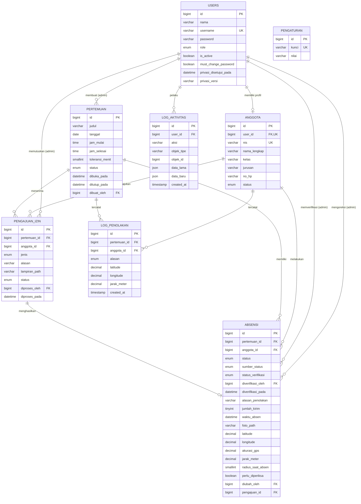
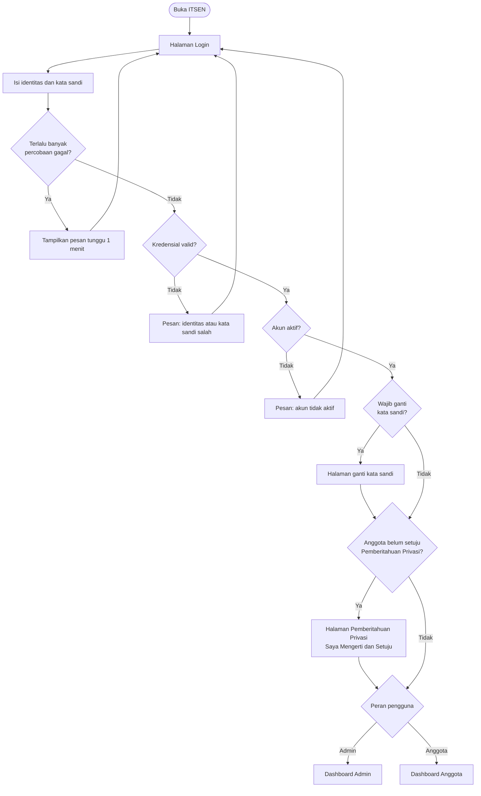
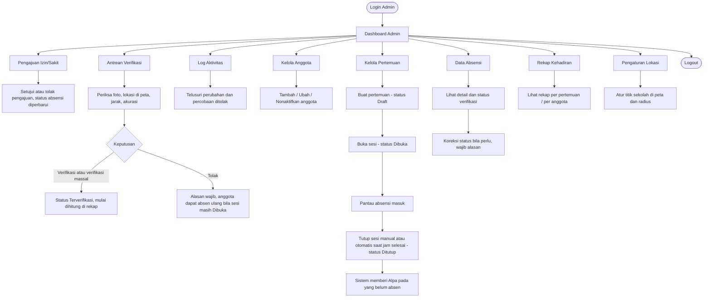
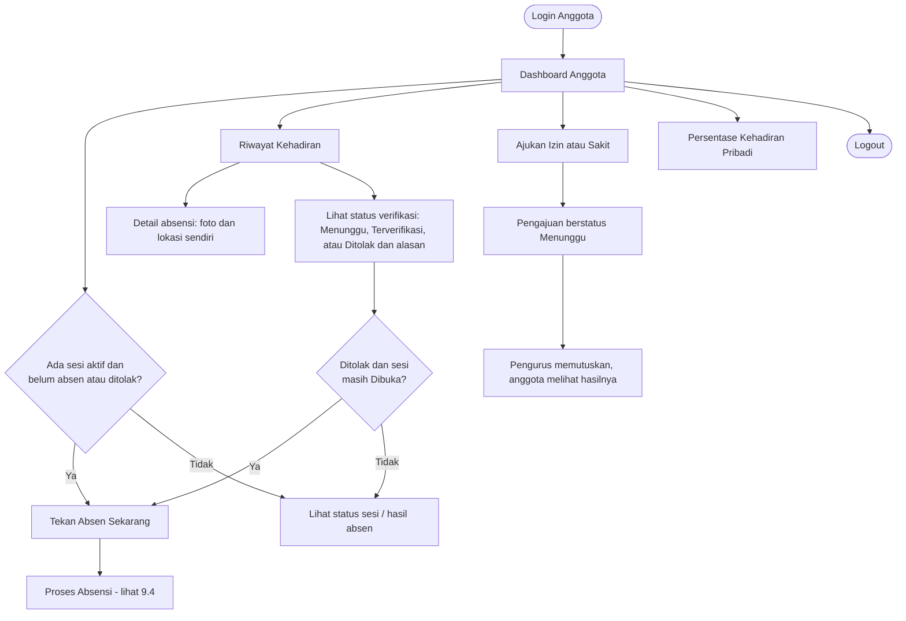
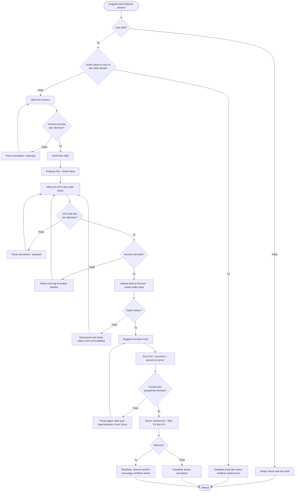
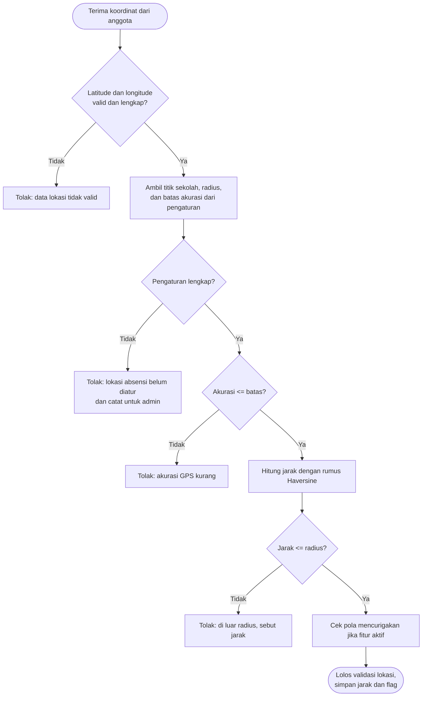
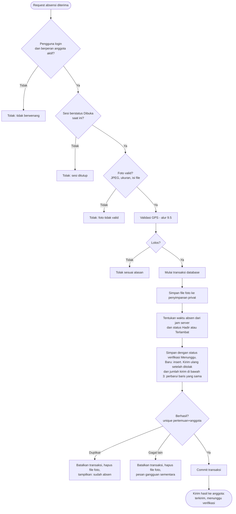
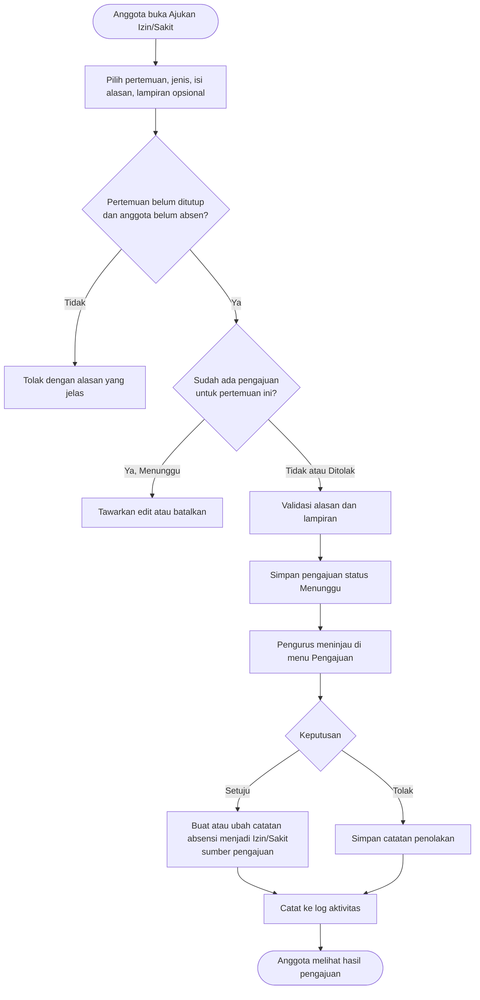
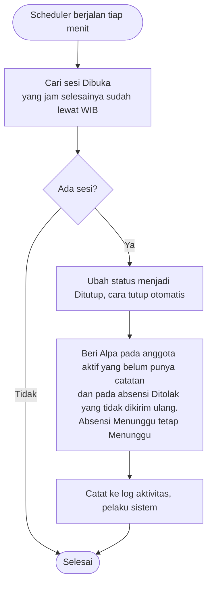
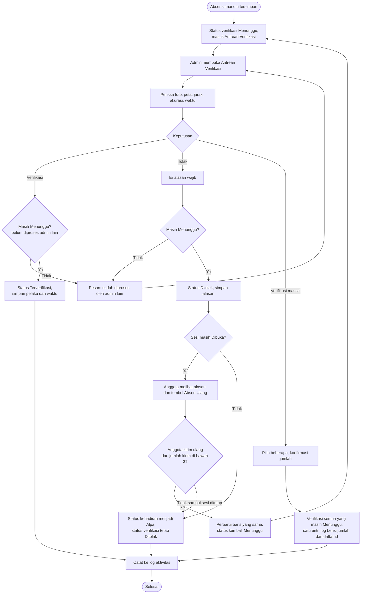

# Product Requirements Document (PRD)

# ITSEN — IT Club Attendance System

| Item | Keterangan |
|---|---|
| Versi dokumen | 1.2 (Draft untuk review) |
| Tanggal | 21 November 2026 |
| Jenis dokumen | PRD + analisis sistem |
| Target pembaca | Developer (pelajar SMK RPL/PPLG), pembina, dan pengurus IT Club |
| Status | Draf. Bagian bertanda **[PERLU KONFIRMASI]** belum menjadi keputusan final |

### Riwayat Revisi

| Versi | Tanggal | Perubahan |
|---|---|---|
| 1.0 | 20 Nov 2026 | Draf awal |
| 1.1 | 21 Nov 2026 | **Keputusan ditetapkan:** K-02 (login pakai username/NIS), K-04 (sesi tutup otomatis), K-08 (log penolakan), K-09 (ekspor CSV), K-10 (rumus persentase), K-13 (anggota boleh mengajukan izin/sakit), K-15 (retensi data). **Fitur baru:** F-13 Pengajuan Izin/Sakit, F-15 Log Aktivitas dan Log Penolakan, F-16 Privasi dan Retensi Data. **Teknis:** zona waktu WIB, Laravel Scheduler. **Database:** tabel baru `pengajuan_izin`, `log_penolakan`, `log_aktivitas`. Kolom `users` diubah |
| 1.2 | 21 Nov 2026 | **Fitur baru:** F-14 Verifikasi Absensi oleh Admin. Absensi mandiri yang lolos validasi otomatis berstatus Menunggu, baru dihitung hadir setelah admin memverifikasi. Mencakup antrean verifikasi, verifikasi massal, penolakan dengan alasan, kirim ulang selama sesi dibuka (maks. 3 kali), dan Alpa otomatis bila ditolak lalu sesi ditutup. **Dihapus:** fitur Periode (tahun ajaran), tabel `periode`, kolom `pertemuan.periode_id`, filter dan chip periode. **Database:** kolom baru di `absensi` (`status_verifikasi`, `diverifikasi_oleh`, `diverifikasi_pada`, `alasan_penolakan`, `jumlah_kirim`). **Rumus persentase (K-10)** kini hanya menghitung absensi Terverifikasi |
| – | – | **Tidak diambil di v1.1:** kode sesi (K-12 ditunda), penguatan foto (cap waktu dan thumbnail), peran Pembina di dalam aplikasi |

---

## Daftar Isi

1. [Ringkasan Produk](#1-ringkasan-produk)
2. [Latar Belakang, Tujuan, dan Indikator Keberhasilan](#2-latar-belakang-tujuan-dan-indikator-keberhasilan)
3. [Teknologi](#3-teknologi)
4. [Jenis Pengguna dan Hak Akses](#4-jenis-pengguna-dan-hak-akses)
5. [Fitur Utama](#5-fitur-utama)
6. [Mekanisme Absensi](#6-mekanisme-absensi)
7. [Status Kehadiran](#7-status-kehadiran)
8. [Struktur Database](#8-struktur-database)
9. [User Flow dan System Flow](#9-user-flow-dan-system-flow)
10. [Rancangan UI/UX](#10-rancangan-uiux)
11. [Kebutuhan Nonfungsional](#11-kebutuhan-nonfungsional)
12. [Batasan Produk](#12-batasan-produk)
13. [Acceptance Criteria](#13-acceptance-criteria)
14. [Tahap Pengembangan](#14-tahap-pengembangan)
15. [Keputusan yang Perlu Dikonfirmasi](#15-keputusan-yang-perlu-dikonfirmasi)
16. [Glosarium](#16-glosarium)

---

## 1. Ringkasan Produk

### 1.1 Identitas

| Item | Nilai |
|---|---|
| Nama aplikasi | ITSEN |
| Kepanjangan | IT Club Attendance System |
| Jenis | Web Application + Progressive Web App (PWA) |
| Platform | Android, iOS, Desktop (melalui browser modern atau instalasi PWA) |
| Pengguna | Anggota dan pengurus ekstrakurikuler IT Club |
| Bahasa antarmuka | Bahasa Indonesia |

### 1.2 Deskripsi Singkat

ITSEN adalah aplikasi absensi digital untuk ekstrakurikuler IT Club. Anggota mencatat kehadiran sendiri dengan **foto selfie** dan **lokasi GPS** melalui HP. Pengurus memantau kehadiran lewat dashboard admin. Aplikasi dapat dipasang di layar utama HP (PWA) tanpa membuat aplikasi Android native.

### 1.3 Penanda Status Keputusan

Agar dokumen ini tidak menimbulkan salah paham, setiap isi dibedakan sebagai berikut:

| Penanda | Arti |
|---|---|
| **[DITETAPKAN]** | Sudah ditetapkan di kebutuhan awal dan wajib diikuti |
| **[DITETAPKAN v1.1]** | Diputuskan pada revisi 1.1 berdasarkan pilihan pemilik produk. Mengikat seperti [DITETAPKAN], tetapi angka tertentu (misalnya radius dan retensi) tetap perlu diuji lapangan |
| **[REKOMENDASI]** | Usulan teknis dari penyusun PRD. Boleh diubah jika ada alasan yang jelas |
| **[PERLU KONFIRMASI]** | Belum diputuskan. Harus dibahas dengan pembina/pengurus sebelum dikembangkan |

Daftar lengkap butir konfirmasi ada di [Bagian 15](#15-keputusan-yang-perlu-dikonfirmasi).

---

## 2. Latar Belakang, Tujuan, dan Indikator Keberhasilan

### 2.1 Latar Belakang **[DITETAPKAN]**

Absensi manual (tanda tangan atau daftar kertas) pada ekstrakurikuler IT Club memiliki kelemahan:

- Mudah dititipkan ke teman (titip absen).
- Rekap kehadiran harus dihitung manual dan rawan salah.
- Data kertas mudah hilang dan sulit dicari kembali.
- Tidak ada bukti bahwa anggota benar-benar hadir di lokasi.

ITSEN menggantikan proses ini dengan absensi mandiri berbasis foto selfie dan GPS, dengan data tersimpan di database.

### 2.2 Tujuan Produk

1. Mencatat kehadiran anggota per pertemuan secara digital dan akurat.
2. Menyediakan bukti kehadiran berupa foto, koordinat, dan waktu.
3. Mempercepat pembuatan rekap kehadiran bagi pengurus.
4. Memudahkan anggota memantau kehadiran dan persentasenya sendiri.

### 2.3 Indikator Keberhasilan **[REKOMENDASI]**

Angka berikut adalah usulan target dan dapat disesuaikan.

| Indikator | Target |
|---|---|
| Waktu anggota menyelesaikan absensi (buka halaman sampai hasil tampil) | ≤ 1 menit pada kondisi normal |
| Absensi ganda pada satu sesi | 0 kasus (dicegah oleh sistem) |
| Rekap kehadiran satu pertemuan dapat dilihat pengurus | ≤ 5 detik setelah halaman dibuka |
| Semua acceptance criteria di Bagian 13 lulus | 100% sebelum deployment |

---

## 3. Teknologi

### 3.1 Teknologi yang Digunakan **[DITETAPKAN]**

| Lapisan | Teknologi | Fungsi di ITSEN |
|---|---|---|
| Backend | Laravel (PHP) | Routing, autentikasi, validasi, logika bisnis, penyimpanan file |
| Database | MySQL | Menyimpan seluruh data |
| Frontend | Blade Template | Merender halaman dari server |
| Styling | Tailwind CSS | Tampilan responsif dan konsisten |
| Interaksi | JavaScript | Kamera, GPS, pengiriman data absensi, interaksi halaman |
| Kamera | MediaDevices API | Mengambil foto selfie langsung dari kamera |
| Lokasi | Geolocation API | Mengambil latitude, longitude, dan akurasi |
| PWA | Web App Manifest + Service Worker | Instalasi di layar utama dan cache aset statis |
| Peta | Leaflet + OpenStreetMap | Menampilkan titik sekolah, radius, dan lokasi anggota |

### 3.2 Prinsip Pemilihan Teknologi

- Tidak ada teknologi tambahan di luar tabel di atas, kecuali ada alasan yang jelas dan disetujui tim.
- Paket Laravel bawaan (autentikasi sesi, validasi, storage, CSRF) dipakai lebih dulu sebelum menambah paket pihak ketiga.
- Hitung jarak GPS (rumus Haversine) dibuat sebagai fungsi sendiri di backend, tanpa library tambahan.
- **[DITETAPKAN v1.1]** Penutupan sesi otomatis dan penghapusan data sesuai retensi memakai **Laravel Scheduler** (bawaan Laravel, bukan paket tambahan). Alasannya: tugas harus berjalan sendiri tanpa menunggu admin. Syaratnya hosting mendukung *cron job* (lihat K-17).
- **[DITETAPKAN v1.1]** Ekspor rekap berformat CSV dibuat dengan fungsi bawaan PHP, tanpa paket tambahan.

---

## 4. Jenis Pengguna dan Hak Akses

**[DITETAPKAN]** Terdapat dua peran: Admin/Pengurus dan Anggota.

### 4.1 Matriks Hak Akses

| Kemampuan | Admin/Pengurus | Anggota |
|---|:---:|:---:|
| Login dan logout | ✅ | ✅ |
| Dashboard admin | ✅ | ❌ |
| Dashboard anggota | ❌ | ✅ |
| Kelola data anggota (CRUD) | ✅ | ❌ |
| Buat sesi pertemuan | ✅ | ❌ |
| Buka dan tutup sesi absensi | ✅ | ❌ |
| Melakukan absensi (selfie + GPS) | ❌ | ✅ |
| Lihat seluruh data absensi | ✅ | ❌ |
| Lihat foto bukti kehadiran | ✅ | Hanya foto miliknya **[REKOMENDASI]** |
| Lihat lokasi GPS anggota | ✅ | Hanya lokasinya sendiri **[REKOMENDASI]** |
| Lihat rekap kehadiran seluruh anggota | ✅ | ❌ |
| Ekspor rekap (CSV) | ✅ | ❌ |
| Lihat riwayat dan persentase kehadiran pribadi | ❌ | ✅ |
| Memverifikasi atau menolak absensi (F-14) | ✅ | ❌ |
| Verifikasi massal (F-14) | ✅ | ❌ |
| Mengirim ulang absensi yang ditolak, selama sesi Dibuka (F-14) | ❌ | ✅ |
| Atur titik koordinat sekolah dan radius | ✅ | ❌ |
| Mengajukan izin/sakit (F-13) | ❌ | ✅ |
| Menyetujui/menolak pengajuan izin/sakit | ✅ | ❌ |
| Lihat log aktivitas dan log penolakan (F-15) | ✅ | ❌ |

### 4.2 Catatan

- Satu akun hanya memiliki satu peran.
- Admin tidak ikut absensi sebagai anggota. Jika pengurus juga anggota IT Club dan perlu absen, solusinya adalah membuat akun anggota terpisah. **[PERLU KONFIRMASI]** (butir K-01)
- Hak akses diperiksa di sisi server pada setiap request. Menyembunyikan menu saja tidak cukup.

---

## 5. Fitur Utama

Setiap fitur dijelaskan dengan format: tujuan, alur, aturan bisnis, validasi, dan kondisi gagal. Kode fitur (F-01 dst.) dipakai pada Acceptance Criteria di Bagian 13.

### F-01. Autentikasi dan Manajemen Akun

**Tujuan:** memastikan hanya pengguna terdaftar yang bisa masuk dan setiap orang hanya melihat halaman sesuai perannya.

**Alur:**
1. Pengguna membuka halaman login.
2. Mengisi identitas login dan kata sandi.
3. Sistem memverifikasi, lalu mengarahkan ke dashboard sesuai peran.
4. Logout mengakhiri sesi.

**Aturan bisnis:**

| Aturan | Status |
|---|---|
| Tidak ada registrasi mandiri. Akun anggota dibuat oleh admin | **[REKOMENDASI]** |
| Identitas login adalah **username**. Untuk anggota, username = NIS. Admin memakai username yang dibuat admin. Tidak ada login dengan email | **[DITETAPKAN v1.1]** (K-02) |
| Akun dengan status nonaktif tidak bisa login | **[REKOMENDASI]** |
| Kata sandi awal dibuat admin dan wajib diganti saat login pertama | **[REKOMENDASI]** |
| Setelah ganti kata sandi, anggota membaca dan menyetujui Pemberitahuan Privasi sebelum bisa memakai aplikasi (lihat F-16) | **[DITETAPKAN v1.1]** |
| Anggota dapat mengganti kata sandi sendiri | **[REKOMENDASI]** |
| Admin dapat mereset kata sandi anggota | **[REKOMENDASI]** |
| Fitur "lupa kata sandi" lewat email | Di luar cakupan awal, cukup reset oleh admin |
| Pembatasan percobaan login: maksimal 5 kali gagal lalu ditunda 1 menit | **[REKOMENDASI]** |

**Validasi:** identitas dan kata sandi wajib diisi. Kata sandi baru minimal 8 karakter dan tidak boleh sama dengan identitas login.

**Kondisi gagal:**

| Kondisi | Respons Sistem |
|---|---|
| Kredensial salah | Pesan umum "Identitas atau kata sandi salah" tanpa menyebut mana yang salah |
| Akun nonaktif | Pesan "Akun Anda tidak aktif. Hubungi pengurus" |
| Terlalu banyak percobaan | Pesan "Terlalu banyak percobaan. Coba lagi dalam 1 menit" |
| Sesi kedaluwarsa | Diarahkan ke login dengan pesan "Sesi berakhir, silakan login kembali" |

### F-02. Dashboard Admin

**Tujuan:** memberi pengurus gambaran cepat kondisi kehadiran dan akses ke seluruh fitur pengelolaan.

**Isi:**
- Kartu ringkasan: jumlah anggota aktif, jumlah pertemuan, sesi yang sedang dibuka, **absensi yang menunggu verifikasi**, dan **pengajuan izin/sakit yang menunggu keputusan**.
- Panel "Sesi Hari Ini": status sesi, jumlah sudah absen dibanding total anggota, jumlah yang sudah terverifikasi, tombol buka/tutup.
- Daftar absensi terbaru (nama, waktu, status, status verifikasi, jarak).
- Persentase kehadiran rata-rata per pertemuan (5 pertemuan terakhir).
- Pintasan: Antrean Verifikasi, Tambah Anggota, Buat Pertemuan, Pengaturan Lokasi.

**Aturan bisnis:** data dashboard hanya dapat dilihat admin. Angka dihitung dari database saat halaman dibuka (tanpa real-time wajib; refresh manual atau berkala sudah cukup **[REKOMENDASI]**).

**Kondisi gagal:** jika belum ada data, tampilkan keadaan kosong dengan ajakan tindakan ("Belum ada pertemuan. Buat pertemuan pertama").

### F-03. Dashboard Anggota

**Tujuan:** anggota tahu apa yang harus dilakukan sekarang dan bagaimana kehadirannya.

**Isi:**
- Sapaan dan nama anggota.
- Kartu status sesi: "Belum ada sesi aktif" atau "Sesi aktif: [judul]" dengan tombol **Absen Sekarang**.
- Status absensi sesi ini (belum/sudah absen, status, waktu) dan **status verifikasi** (Menunggu, Terverifikasi, atau Ditolak beserta alasan).
- Persentase kehadiran pribadi (hanya absensi Terverifikasi) dan jumlah absensi yang masih menunggu verifikasi.
- 5 riwayat terakhir.
- Tautan "Ajukan Izin/Sakit" dan status pengajuan terakhir (Menunggu/Disetujui/Ditolak).

**Aturan bisnis:** tombol Absen Sekarang hanya aktif jika ada sesi dibuka dan anggota belum absen pada sesi itu. Jika absensinya **Ditolak** admin dan sesi masih Dibuka, tombol berubah menjadi **Absen Ulang**.

### F-04. Manajemen Data Anggota

**Tujuan:** pengurus mengelola daftar anggota yang berhak melakukan absensi.

**Data anggota:** nama lengkap, NIS, kelas, jurusan, nomor HP (opsional), status (aktif/nonaktif), akun login.

**Operasi (CRUD):**

| Operasi | Aturan |
|---|---|
| Tambah | Membuat data anggota dan akun login sekaligus dalam satu proses |
| Lihat | Daftar dengan pencarian (nama/NIS) dan filter (kelas, status) |
| Ubah | Mengubah data profil, status, dan reset kata sandi |
| Hapus | Tidak menghapus permanen jika anggota sudah punya riwayat absensi. Cukup dinonaktifkan agar rekap lama tetap utuh. Hapus permanen hanya untuk anggota tanpa riwayat absensi **[REKOMENDASI]** |

**Validasi:**
- Nama wajib, maksimal 100 karakter.
- NIS wajib, unik, hanya angka.
- Kelas wajib.
- Nomor HP opsional, format angka 8–15 digit.
- Username login anggota dibuat otomatis dari NIS (unik).

**Kondisi gagal:** NIS sudah dipakai menampilkan pesan "NIS sudah terdaftar". Gagal menyimpan salah satu data (anggota atau akun) membatalkan keduanya (transaksi database).

**Impor massal lewat CSV:** di luar cakupan awal. **[PERLU KONFIRMASI]** (K-03)

### F-05. Manajemen Sesi Pertemuan

**Tujuan:** setiap pertemuan IT Club menjadi satu sesi yang membatasi kapan anggota boleh absen.

**Data sesi:** judul, tanggal, jam mulai, jam selesai, batas tepat waktu (menit toleransi), catatan (opsional), dan status sesi.

**Status sesi:**

| Status | Arti | Bisa absen? |
|---|---|:---:|
| Draft | Sesi dibuat tetapi belum dibuka | ❌ |
| Dibuka | Anggota boleh absen | ✅ |
| Ditutup | Absensi selesai | ❌ |

**Aturan bisnis:**
- Admin membuat sesi, lalu membuka dan menutup sesi secara manual. **[DITETAPKAN]** (admin membuka/menutup sesi)
- **[DITETAPKAN v1.1]** (K-04) Sesi **ditutup otomatis** saat tanggal dan jam selesai terlewati (WIB), dijalankan Laravel Scheduler tiap menit. Tombol tutup manual oleh admin tetap tersedia. Penutupan otomatis memicu proses yang sama dengan penutupan manual (pemberian Alpa dan pencatatan ke log aktivitas dengan pelaku "sistem").
- **Pengaman:** saat anggota mengirim absensi, server memeriksa juga waktu sekarang. Jika sudah melewati jam selesai, absensi ditolak meskipun Scheduler belum sempat menutup sesi.
- Maksimal satu sesi berstatus Dibuka dalam satu waktu. **[REKOMENDASI]** (menyederhanakan alur anggota)
- Saat sesi ditutup, anggota aktif yang belum punya catatan otomatis diberi status **Alpa** (lihat Bagian 7). Absensi berstatus **Ditolak** yang belum dikirim ulang juga menjadi Alpa. Absensi berstatus **Menunggu** tidak berubah dan tetap dapat diverifikasi setelah sesi ditutup (F-14).
- Sesi yang sudah punya data absensi tidak boleh dihapus. Cukup ditutup atau dibatalkan. **[REKOMENDASI]**
- Sesi yang sudah ditutup dapat dibuka kembali oleh admin. **[PERLU KONFIRMASI]** (K-05)

**Validasi:** judul wajib, tanggal wajib, jam selesai harus setelah jam mulai.

**Kondisi gagal:** membuka sesi saat ada sesi lain Dibuka menampilkan pesan yang menyebut sesi yang masih terbuka.

### F-06. Absensi Menggunakan Foto Selfie

**Tujuan:** mendapatkan bukti visual bahwa anggota yang bersangkutan hadir.

**Aturan bisnis:**
- Foto **wajib** diambil langsung dari kamera lewat MediaDevices API. Unggah dari galeri tidak diizinkan. **[REKOMENDASI]** (mengurangi pemakaian foto lama)
- Kamera depan menjadi default.
- Anggota melihat pratinjau dan boleh mengulang foto sebelum mengirim.
- Foto diubah ukurannya di browser (maksimal sisi terpanjang 800 px, format JPEG, kualitas sekitar 70%) agar ringan.
- Foto tidak diberi filter atau efek.

**Validasi di server:** tipe file harus gambar JPEG, ukuran maksimal 1 MB **[REKOMENDASI]**, dan server memeriksa isi file yang sebenarnya (bukan hanya ekstensi).

**Kondisi gagal:** lihat tabel penanganan di Bagian 6.4.

**Verifikasi wajah otomatis:** di luar cakupan. Pemeriksaan foto dilakukan manual oleh admin lewat **Verifikasi Absensi (F-14)**. **[DITETAPKAN v1.2]**

### F-07. Pengambilan Lokasi GPS

**Tujuan:** mengetahui posisi anggota saat absen.

**Aturan bisnis:**
- Browser meminta izin lokasi lewat Geolocation API dengan mode akurasi tinggi.
- Data yang diambil: latitude, longitude, akurasi (meter), dan waktu pengambilan.
- Pembacaan lokasi dilakukan saat absensi, bukan di latar belakang.
- Jika akurasi lebih buruk dari batas toleransi (default 50 m **[PERLU KONFIRMASI]**, K-06), anggota diminta mencoba lagi (misalnya pindah ke tempat terbuka).
- Batas waktu menunggu GPS: 15 detik **[REKOMENDASI]**, lalu tampil pesan gagal dan opsi coba lagi.

### F-08. Validasi Radius Lokasi Sekolah

**Tujuan:** memastikan anggota berada di area sekolah.

**Aturan bisnis:**
- Jarak dihitung dengan rumus Haversine antara titik anggota dan titik sekolah (dari tabel `pengaturan`).
- **Perhitungan yang sah dilakukan di server.** Hitungan di browser hanya untuk memberi umpan balik cepat kepada pengguna dan tidak dipercaya.
- Jika jarak ≤ radius, absensi lolos validasi lokasi dan masuk antrean verifikasi admin (F-14). Jika lebih, absensi ditolak dan tidak ada data yang disimpan.
- Nilai default radius: **[PERLU KONFIRMASI]** (K-07). Contoh awal 100 m, disesuaikan luas sekolah dan akurasi GPS di lapangan.
- Absensi ditolak karena di luar radius tetap dicatat sebagai log percobaan (tanpa foto) untuk bahan evaluasi. **[PERLU KONFIRMASI]** (K-08)

### F-09. Riwayat Absensi

**Anggota:** melihat daftar riwayat pribadi (tanggal, judul pertemuan, status, status verifikasi, waktu absen) dengan filter bulan. Dapat membuka detail (foto dan lokasi miliknya).

**Admin:** melihat seluruh data absensi dengan filter pertemuan, tanggal, anggota, status, dan status verifikasi. Detail memuat foto, titik lokasi di peta Leaflet, jarak dari sekolah, akurasi GPS, waktu, dan tombol Verifikasi/Tolak bila masih Menunggu.

**Aturan bisnis:** anggota tidak dapat mengubah atau menghapus riwayat. Admin dapat mengoreksi status dengan alasan wajib diisi. Setiap koreksi dicatat di log aktivitas (pelaku, waktu, status lama dan baru, alasan). **[REKOMENDASI]**

### F-10. Rekap Kehadiran

**Tujuan:** ringkasan kehadiran untuk evaluasi dan pelaporan pembina.

**Isi:**
- Rekap per pertemuan: jumlah per status.
- Rekap per anggota: jumlah Hadir/Terlambat/Izin/Sakit/Alpa dan persentase kehadiran.
- Kolom "Menunggu verifikasi" terpisah pada rekap per pertemuan dan per anggota.
- Filter rentang tanggal.
- **[DITETAPKAN v1.1]** (K-09) Ekspor ke **CSV** (UTF-8, dapat dibuka di Excel) mengikuti filter yang sedang dipakai. Dapat dilakukan Admin. Format Excel (.xlsx) atau PDF ditunda karena butuh paket tambahan.

**Rumus persentase kehadiran:** **[DITETAPKAN v1.1]** (K-10)

Rumus:

```
Persentase Kehadiran = (Hadir + Terlambat yang Terverifikasi) / Total pertemuan yang sudah ditutup × 100%
```

Izin dan Sakit tetap dihitung sebagai bagian dari total pertemuan (tidak dihitung hadir). Hanya pertemuan berstatus Ditutup (pada rentang tanggal yang dipilih, bila ada filter) yang masuk penyebut. **Hadir dan Terlambat hanya dihitung bila Terverifikasi (F-14).** Absensi yang masih Menunggu atau Ditolak tidak dihitung hadir dan ditampilkan terpisah. Alpa dihitung apa pun status verifikasinya. Rumus yang sama dipakai di dashboard anggota, dashboard admin, rekap, dan ekspor.

### F-11. Pengaturan Lokasi dan Radius GPS

**Tujuan:** admin menentukan lokasi sekolah dan seberapa jauh anggota boleh berada saat absen.

**Pengaturan:**

| Pengaturan | Keterangan |
|---|---|
| Latitude sekolah | Koordinat titik pusat |
| Longitude sekolah | Koordinat titik pusat |
| Radius absensi (meter) | Jarak maksimum yang diperbolehkan |
| Batas akurasi GPS (meter) | Pembacaan GPS yang lebih buruk dari ini ditolak |
| Nama lokasi | Label untuk tampilan (misalnya "Lab RPL") |

**Cara input:** admin memilih titik pada peta Leaflet (klik/geser penanda) atau mengisi koordinat manual. Lingkaran radius ditampilkan pada peta sebagai pratinjau.

**Validasi:** latitude −90 s.d. 90, longitude −180 s.d. 180, radius bilangan bulat positif (rentang usulan 10–1000 m).

**Aturan:** perubahan pengaturan berlaku untuk absensi berikutnya dan tidak mengubah data absensi lama. Radius pada saat absen disimpan agar bukti tetap dapat dipahami. **[REKOMENDASI]**

### F-12. Progressive Web App (PWA)

**Tujuan:** ITSEN dapat dipasang seperti aplikasi dan dibuka cepat.

**Kebutuhan:**

| Komponen | Isi |
|---|---|
| Web App Manifest | Nama, nama singkat, ikon (192 px dan 512 px, termasuk maskable), `display: standalone`, warna tema, `start_url`, bahasa `id` |
| Service Worker | Cache aset statis (CSS, JS, ikon, font) dan halaman offline sederhana |
| Instalasi | Android (Chrome): tombol pasang. iOS (Safari): panduan "Tambah ke Layar Utama" |
| HTTPS | Wajib (syarat PWA, kamera, dan GPS) |

**Batasan yang disengaja:**
- **Absensi tidak dapat dilakukan saat offline** dan tidak ada antrean absensi offline. Alasan: waktu dan validasi harus ditentukan server agar tidak bisa dimanipulasi. **[REKOMENDASI]**
- Halaman dinamis (dashboard, data absensi) tidak di-cache agar data tidak basi dan tidak bocor antarpengguna pada perangkat bersama.
- Notifikasi push tidak termasuk cakupan awal.

### F-13. Pengajuan Izin/Sakit oleh Anggota **[DITETAPKAN v1.1]**

**Tujuan:** anggota yang tidak bisa hadir memberi tahu pengurus lewat aplikasi, tanpa jalur selfie dan GPS. Status Izin/Sakit tetap ditentukan pengurus (prinsip Bagian 7 tidak berubah). Anggota hanya **mengajukan**, pengurus yang **memutuskan**.

**Alur:**
1. Anggota membuka "Ajukan Izin/Sakit" dari Beranda atau Riwayat.
2. Memilih pertemuan, jenis (Izin atau Sakit), mengisi alasan, dan boleh melampirkan foto surat/bukti.
3. Pengajuan berstatus **Menunggu**. Pengurus menyetujui atau menolak dari menu Pengajuan.
4. **Disetujui:** catatan absensi anggota pada pertemuan itu dibuat atau diubah menjadi Izin/Sakit (`sumber_status = pengajuan`). **Ditolak:** anggota melihat catatan penolakan, dan status absensi mengikuti aturan normal (Alpa jika tidak hadir).

**Aturan bisnis:**

| Aturan | Keterangan |
|---|---|
| Pertemuan yang dapat diajukan | Berstatus Draft atau Dibuka (belum ditutup). Batas waktu pengajuan yang lebih rinci (misalnya paling lambat H-1) **[PERLU KONFIRMASI]** (K-19) |
| Satu pengajuan per anggota per pertemuan | Pengajuan Menunggu dapat dibatalkan atau diedit anggota. Pengajuan Ditolak/Dibatalkan dapat diajukan ulang pada baris yang sama |
| Tidak boleh jika sudah absen | Jika sudah tercatat Hadir/Terlambat (berstatus Menunggu atau Terverifikasi) pada pertemuan itu, pengajuan ditolak sistem. Jika absensinya Ditolak admin, anggota boleh mengajukan izin/sakit |
| Anggota dengan pengajuan Disetujui tidak absen selfie | Catatan absensinya sudah ada. Jika ternyata hadir, pengurus mengoreksi status (tercatat di log) |
| Pengajuan masih Menunggu saat sesi ditutup | Anggota tetap diberi Alpa otomatis. Jika pengajuan kemudian disetujui, Alpa diubah menjadi Izin/Sakit |
| Pengurus dapat memproses pengajuan setelah sesi ditutup | Ya, hasilnya memperbarui rekap |
| Lampiran | Opsional, JPEG/PNG maksimal 2 MB, disimpan privat, mengikuti aturan retensi F-16 |
| Pencatatan | Setiap persetujuan/penolakan masuk log aktivitas (F-15) |

**Validasi:** jenis wajib (Izin/Sakit), alasan wajib 5–255 karakter, pertemuan wajib dipilih, lampiran memenuhi tipe dan ukuran.

**Kondisi gagal:**

| Kondisi | Respons Sistem |
|---|---|
| Pertemuan sudah ditutup | "Pertemuan ini sudah ditutup. Hubungi pengurus" |
| Sudah ada pengajuan aktif | Tampilkan pengajuan yang ada dan tawarkan edit/batalkan |
| Sudah absen di pertemuan itu | "Kamu sudah mengirim absensi pada pertemuan ini" |
| Lampiran terlalu besar/tipe salah | Pesan validasi pada kolom lampiran, pengajuan tidak tersimpan |
| Internet terputus | Data form dipertahankan di layar, tombol Kirim Ulang |

### F-14. Verifikasi Absensi oleh Admin **[DITETAPKAN v1.2]**

**Tujuan:** absensi mandiri baru sah setelah admin memeriksa foto dan lokasinya lalu memverifikasi. Ini menjadikan pemeriksaan foto (mitigasi nomor 6 di Bagian 6.5) langkah resmi, bukan sekadar anjuran.

**Status verifikasi** (terpisah dari status kehadiran di Bagian 7):

| Status verifikasi | Arti | Dihitung hadir di rekap? |
|---|---|:---:|
| **Menunggu** | Absensi terkirim dan lolos validasi otomatis, belum diperiksa admin | ❌ |
| **Terverifikasi** | Admin memeriksa dan menyetujui | ✅ (Hadir/Terlambat) |
| **Ditolak** | Admin menilai bukti tidak sah. Alasan wajib | ❌ |

**Prinsip:**
- Status kehadiran **Hadir atau Terlambat tetap ditentukan sistem saat anggota mengirim**, dari waktu server saat kirim, bukan saat admin memverifikasi. Verifikasi tidak mengubahnya. Jika admin ingin mengubah status, gunakan Koreksi Status (F-09).
- **Hanya absensi mandiri** (`sumber_status = anggota`) yang melewati verifikasi. Alpa otomatis, Izin/Sakit dari pengajuan yang disetujui, dan input atau koreksi manual pengurus langsung berstatus Terverifikasi dan tidak masuk antrean.
- Verifikasi dapat dilakukan kapan saja setelah absensi terkirim, termasuk setelah sesi ditutup.

**Alur:**
1. Anggota mengirim absensi. Data tersimpan dengan status verifikasi **Menunggu**.
2. Admin membuka **Antrean Verifikasi** (jumlah antrean tampil di menu dan dashboard).
3. Admin memeriksa foto (wajah sesuai, latar di sekolah), titik lokasi di peta, jarak, akurasi GPS, waktu, dan penanda "perlu diperiksa" bila K-11 diaktifkan.
4. Admin menekan **Verifikasi** atau **Tolak** (dengan alasan).

**Aturan bisnis:**

| Aturan | Keterangan |
|---|---|
| Verifikasi satu absensi | Status menjadi Terverifikasi. Pelaku dan waktu tersimpan |
| Verifikasi massal | Admin dapat mencentang beberapa absensi lalu menekan "Verifikasi Terpilih". Konfirmasi menyebut jumlahnya. "Pilih semua" melewati baris bertanda perlu diperiksa (bila K-11 aktif) agar tidak terverifikasi tanpa dilihat. Satu entri log memuat jumlah dan daftar id |
| Tolak | Alasan **wajib**: pilihan cepat ("Foto tidak jelas", "Wajah tidak sesuai", "Foto bukan di lokasi sekolah", "Lainnya") dan catatan bebas opsional. Alasan disimpan di `alasan_penolakan` |
| Ditolak saat sesi masih Dibuka | Anggota melihat alasan dan tombol **Absen Ulang**. Kirim ulang memperbarui baris yang sama: foto dan lokasi lama diganti (file lama dihapus), waktu dan status Hadir/Terlambat dihitung ulang dari waktu kirim ulang, status verifikasi kembali Menunggu, `jumlah_kirim` bertambah. Alasan penolakan sebelumnya tetap tercatat di log aktivitas |
| Batas kirim | Maksimal **3 kali pengiriman** per pertemuan **[REKOMENDASI]** (K-20). Setelah itu anggota menghubungi pengurus |
| Ditolak lalu sesi ditutup | Bila anggota tidak mengirim ulang sampai sesi ditutup (manual atau otomatis), status kehadiran menjadi **Alpa** (`sumber_status = sistem`) dan status verifikasi tetap Ditolak dengan alasannya. Pengurus dapat mengoreksi lewat Koreksi Status |
| Ditolak setelah sesi sudah ditutup | Status kehadiran langsung menjadi Alpa. Anggota tidak dapat kirim ulang |
| Masih Menunggu saat sesi ditutup | Tidak berubah. Tidak menjadi Alpa. Tetap menunggu diperiksa |
| Urutan antrean | Yang bertanda perlu diperiksa lebih dulu (bila K-11 aktif), lalu yang paling lama menunggu |
| Dua admin memproses bersamaan | Aksi kedua ditolak dengan pesan "Sudah diproses oleh [nama]" dan daftar dimuat ulang |
| Retensi | Foto absensi berstatus Menunggu tidak dihapus oleh tugas retensi sampai diverifikasi atau ditolak **[REKOMENDASI]** |
| Pencatatan | Setiap verifikasi, penolakan, dan verifikasi massal masuk log aktivitas (F-15) |
| Tampilan anggota | Status verifikasi tampil di Beranda, layar hasil, Riwayat, dan Detail Riwayat. Tidak ada notifikasi push, sehingga anggota perlu membuka aplikasi |

**Validasi:** alasan penolakan wajib 5–255 karakter (gabungan pilihan cepat dan catatan).

**Kondisi gagal:**

| Kondisi | Respons Sistem |
|---|---|
| Tolak tanpa alasan | Ditolak dengan pesan validasi, status tidak berubah |
| Absensi sudah diproses admin lain | Pesan "Sudah diproses oleh [nama]", daftar dimuat ulang |
| Anggota mengirim ulang saat masih Menunggu atau Terverifikasi | "Absensi kamu sudah terkirim (status: [Menunggu/Terverifikasi])" |
| Anggota mengirim ulang setelah 3 kali | "Batas pengiriman tercapai. Hubungi pengurus" |
| Anggota mengirim ulang setelah sesi ditutup | "Sesi absensi sudah ditutup" |
| Internet terputus saat memproses | Pesan jelas, tidak ada perubahan setengah jadi |

### F-15. Log Aktivitas dan Log Penolakan **[DITETAPKAN v1.1]**

**Log aktivitas** mencatat aksi penting agar perubahan data dapat ditelusuri.

| Dicatat | Isi catatan |
|---|---|
| Buka/tutup sesi (manual atau otomatis), buka kembali sesi | Pelaku (atau "sistem"), pertemuan |
| Koreksi status absensi | Status lama dan baru, alasan |
| Persetujuan/penolakan pengajuan izin/sakit | Pengajuan, keputusan, catatan |
| Tambah/ubah/nonaktifkan anggota, reset kata sandi | Anggota yang terdampak (tanpa menyimpan kata sandi) |
| Ubah pengaturan lokasi, radius, akurasi, retensi | Nilai lama dan baru |
| Verifikasi atau penolakan absensi, termasuk verifikasi massal | Absensi (atau jumlah dan daftar id), keputusan, alasan penolakan |
| Absensi Ditolak yang dikirim ulang | Alasan penolakan sebelumnya dan nomor pengiriman |
| Penghapusan data karena retensi | Jumlah item yang dihapus (bukan isinya) |

Aturan: log hanya dapat dilihat Admin, tidak dapat diubah atau dihapus lewat aplikasi (hanya ditambah), dan dapat difilter berdasarkan tanggal, pelaku, dan jenis aksi.

**Log penolakan absensi** mencatat percobaan absensi yang ditolak karena **lokasi**.

- Dicatat untuk alasan: di luar radius dan akurasi GPS buruk. Berisi waktu, anggota, pertemuan, koordinat, akurasi, jarak, dan radius saat itu. **Tidak ada foto.**
- Penolakan alasan lain (sesi ditutup, absensi ganda, dsb.) tidak dicatat agar log tetap relevan.
- Dilihat Admin pada tab "Percobaan Ditolak" di halaman Data Absensi. Tidak ditampilkan ke anggota.
- Kegunaan: membantu membedakan anggota yang memang di luar sekolah dari radius/akurasi yang terlalu ketat, dan menjadi bahan evaluasi pengaturan lokasi.
- Mengikuti aturan retensi F-16.

### F-16. Privasi dan Retensi Data **[DITETAPKAN v1.1]**

**Tujuan:** foto dan lokasi adalah data pribadi siswa. Data dikumpulkan seperlunya, dijelaskan kepada pemiliknya, dan tidak disimpan selamanya.

**Pemberitahuan Privasi:**
- Ditampilkan setelah anggota mengganti kata sandi pada login pertama. Memuat: data yang dikumpulkan (foto selfie, lokasi saat absen, waktu), tujuan, siapa yang dapat melihat, dan lama penyimpanan.
- Anggota menekan "Saya Mengerti dan Setuju" untuk melanjutkan. Waktu persetujuan dan versi teks disimpan.
- Jika teks diperbarui (versi naik), persetujuan diminta ulang.
- Anggota yang belum setuju tidak dapat absen. Penanganannya manual oleh pengurus.
- Tautan "Kebijakan Privasi" tersedia di halaman Profil.
- Isi teks ditinjau pembina/sekolah sebelum rilis. **[PERLU KONFIRMASI]** (K-18)

**Retensi (K-15):**

| Data | Perlakuan | Default |
|---|---|---|
| Foto absensi dan lampiran pengajuan | File dihapus | 12 bulan setelah tanggal pertemuan |
| Koordinat dan akurasi GPS (absensi dan log penolakan) | Dikosongkan (NULL) | 12 bulan setelah tanggal pertemuan |
| Status, waktu, dan jarak | Tetap disimpan untuk rekap | – |

- Dijalankan harian oleh Laravel Scheduler. Lama retensi disimpan di pengaturan (`retensi_bulan`) dan dapat diubah admin.
- Absensi yang masih berstatus **Menunggu verifikasi** dikecualikan dari penghapusan sampai diverifikasi atau ditolak (F-14).
- Setelah dihapus, detail absensi menampilkan "Foto dan lokasi sudah dihapus sesuai kebijakan retensi".
- Cadangan (*backup*) juga berisi data pribadi sehingga harus disimpan aman dan tunduk pada aturan yang sama.

---

## 6. Mekanisme Absensi

### 6.1 Prasyarat

Anggota sudah login, ada sesi berstatus Dibuka, anggota berstatus aktif, belum punya catatan absensi di sesi itu (atau absensinya Ditolak dan masih boleh dikirim ulang, F-14), dan perangkat memiliki kamera, GPS, serta koneksi internet.

### 6.2 Langkah Absensi **[DITETAPKAN]**

| No | Langkah | Pelaku |
|---|---|---|
| 1 | Anggota login | Anggota |
| 2 | Membuka halaman absensi | Anggota |
| 3 | Sistem memeriksa apakah sesi aktif | Sistem |
| 4 | Anggota mengambil foto selfie dengan kamera HP | Anggota |
| 5 | Sistem meminta izin akses GPS | Sistem |
| 6 | Sistem mendapatkan latitude dan longitude | Sistem |
| 7 | Sistem menghitung jarak anggota ke titik sekolah | Sistem |
| 8 | Sistem memeriksa apakah dalam radius | Sistem |
| 9 | Anggota menekan tombol kirim | Anggota |
| 10 | Sistem menyimpan foto, lokasi, waktu, dan identitas anggota dengan status verifikasi **Menunggu** | Sistem |
| 11 | Sistem menampilkan bahwa absensi terkirim dan menunggu verifikasi admin | Sistem |
| 12 | Admin memeriksa foto dan lokasi, lalu memverifikasi atau menolak (F-14) | Admin |

**Catatan:** langkah 12 ditambahkan pada v1.2 atas permintaan pemilik produk.

**Catatan implementasi:** langkah 7–8 dijalankan dua kali. Sekali di browser untuk umpan balik cepat (tombol kirim hanya aktif bila lolos), dan sekali lagi **di server saat langkah 10** sebagai pemeriksaan yang sah. Server juga memeriksa ulang sesi masih dibuka dan anggota belum absen, karena kondisi bisa berubah antara langkah 3 dan 9.

### 6.3 Aturan Inti

- Foto selfie dan GPS adalah komponen **wajib**. Absensi tanpa salah satunya ditolak.
- **Waktu absensi ditentukan oleh server**, bukan jam HP anggota.
- **Identitas anggota diambil dari sesi login**, bukan dari data yang dikirim form.
- **Pencegahan absensi ganda:** dijaga di dua lapis, yaitu pemeriksaan di aplikasi dan *unique constraint* `(pertemuan_id, anggota_id)` di database. Lapis database penting untuk kasus tombol kirim ditekan dua kali atau dua perangkat bersamaan. Satu-satunya pengecualian adalah kirim ulang setelah ditolak admin (memperbarui baris yang sama, F-14).
- **Setelah tersimpan, absensi berstatus Menunggu verifikasi** dan belum dihitung hadir pada rekap resmi sampai admin memverifikasi (F-14).
- Tombol kirim dinonaktifkan setelah ditekan (mencegah klik ganda) dan menampilkan indikator proses.
- Waktu yang dipakai seluruh aplikasi adalah **WIB (Asia/Jakarta)**, ditentukan oleh server. Sesi dianggap tertutup jika waktu server melewati tanggal dan jam selesai, walaupun Scheduler belum menutupnya.
- Percobaan yang ditolak karena lokasi (di luar radius atau akurasi buruk) dicatat ke **log penolakan** (F-15), tanpa foto.
- Foto dan data lokasi dikirim dalam **satu permintaan** dan disimpan dalam satu transaksi. Tidak boleh ada kondisi "foto tersimpan, tetapi data absensi tidak ada" atau sebaliknya.

### 6.4 Penanganan Kondisi Gagal

| Kondisi | Deteksi | Respons Sistem | Tindak Lanjut Pengguna |
|---|---|---|---|
| **GPS tidak aktif** | Geolocation mengembalikan kegagalan posisi tidak tersedia | Pesan: "GPS tidak aktif. Nyalakan lokasi di pengaturan HP" + tombol Coba Lagi | Aktifkan GPS lalu coba lagi |
| **Izin lokasi ditolak** | Geolocation mengembalikan *permission denied* | Pesan langkah mengaktifkan izin lokasi untuk situs ITSEN (instruksi ringkas untuk Chrome Android dan Safari iOS). Tombol kirim tetap nonaktif | Ubah izin di pengaturan browser, muat ulang |
| **Kamera tidak tersedia** | MediaDevices gagal (tidak ada kamera, izin ditolak, kamera dipakai aplikasi lain) | Pesan sesuai penyebab. Tidak ada jalur alternatif tanpa foto | Beri izin kamera, tutup aplikasi lain, atau pakai perangkat lain. Jika benar-benar tidak bisa, hubungi pengurus untuk pencatatan manual (lihat 7.3) |
| **Foto gagal diunggah** | Respons server error atau waktu habis | Data di layar (foto dan lokasi) dipertahankan, tampil "Gagal mengirim. Coba lagi" + tombol Kirim Ulang. Server tidak menyimpan data setengah jadi | Kirim ulang tanpa mengulang foto |
| **Internet terputus** | Permintaan gagal tanpa respons / indikator offline browser | Pesan "Tidak ada koneksi internet". Data di layar dipertahankan. Tidak ada antrean offline | Sambungkan internet lalu kirim ulang |
| **Lokasi di luar radius** | Server menghitung jarak > radius | Ditolak dengan pesan: "Anda berada [X] meter dari lokasi absensi (maks. [R] m)". Tidak ada absensi tersimpan | Pindah ke area sekolah, lalu coba lagi |
| **Akurasi GPS buruk** | Akurasi > batas toleransi | Pesan "Sinyal GPS kurang akurat, pindah ke tempat terbuka" + coba lagi | Coba ulang di tempat terbuka |
| **Sesi absensi sudah ditutup** | Server memeriksa status sesi saat kirim | Ditolak: "Sesi absensi sudah ditutup" | Hubungi pengurus bila ada alasan sah |
| **Tidak ada sesi aktif** | Halaman absensi memeriksa sesi | Tampil "Belum ada sesi absensi aktif", tombol absen tidak ada | Tunggu pengurus membuka sesi |
| **Absensi berulang** | Pemeriksaan aplikasi + unique constraint | Jika Menunggu atau Terverifikasi: ditolak ramah "Anda sudah absen pada sesi ini pukul [jam]" + tampilkan hasil dan status verifikasinya. Jika Ditolak admin dan sesi masih Dibuka: kirim ulang diizinkan (maks. 3 kali) | Tidak perlu tindakan, atau kirim ulang bila ditolak |
| **Absensi ditolak admin** | Status verifikasi Ditolak | Beranda dan Riwayat menampilkan alasan dan tombol Absen Ulang selama sesi Dibuka. Setelah sesi ditutup, status menjadi Alpa | Perbaiki penyebab (misalnya foto lebih jelas) lalu kirim ulang, atau hubungi pengurus |
| **Sesi login berakhir** | Server mengembalikan status tidak terautentikasi | Arahkan ke login dengan pesan jelas. Data foto di layar mungkin hilang | Login lalu ulangi |
| **Kuota penyimpanan server penuh** | Gagal menulis file | Pesan umum "Terjadi gangguan, coba lagi nanti" + kejadian dicatat di log untuk admin | Hubungi pengurus |

### 6.5 Keterbatasan GPS Browser dan Mitigasi

**Perlu dipahami: GPS pada browser tidak sepenuhnya anti-manipulasi.** ITSEN tidak boleh mengklaim sebaliknya, termasuk dalam dokumentasi dan tampilan aplikasi.

**Keterbatasan:**

| Keterbatasan | Penjelasan |
|---|---|
| Lokasi palsu (*mock location*) | Di Android, aplikasi pemalsu lokasi dapat membuat browser melaporkan koordinat apa pun. Browser web tidak dapat mendeteksinya secara andal |
| Emulator dan alat pengembang | Browser desktop dapat diatur untuk melaporkan lokasi buatan lewat alat pengembang |
| VPN/proxy | Memengaruhi lokasi berbasis IP, bukan GPS, tetapi bisa mengacaukan perkiraan lokasi pada perangkat tanpa GPS |
| Akurasi bervariasi | Di dalam gedung atau perangkat tanpa chip GPS, lokasi bisa meleset puluhan hingga ratusan meter |
| Data dikirim oleh klien | Server hanya menerima angka koordinat. Server tidak bisa memastikan angka itu berasal dari GPS asli |
| Foto bukan jaminan waktu/tempat | Foto dari kamera tidak memuat bukti lokasi yang dapat dipercaya |

**Mitigasi realistis:** semua langkah di bawah bersifat *mengurangi* risiko, bukan menghilangkannya.

| No | Mitigasi | Status | Efek |
|---|---|---|---|
| 1 | Foto hanya dari kamera langsung (tanpa unggah galeri) | **[REKOMENDASI]** | Mempersulit pemakaian foto lama |
| 2 | Waktu ditentukan server | **[DITETAPKAN]** (waktu disimpan oleh sistem) | Mencegah manipulasi jam HP |
| 3 | Hitungan jarak di server | **[REKOMENDASI]** | Mencegah manipulasi validasi di browser |
| 4 | Menyimpan akurasi GPS dan jarak pada setiap absensi | **[REKOMENDASI]** | Bahan pemeriksaan pengurus |
| 5 | Batas akurasi GPS maksimum | **[REKOMENDASI]** | Menolak pembacaan lokasi yang sangat kasar |
| 6 | Admin memeriksa dan memverifikasi setiap absensi mandiri (wajah sesuai, latar di sekolah) sebelum dihitung hadir (F-14) | **[DITETAPKAN v1.2]** | Mitigasi paling efektif pada skala klub kecil. Titip absen dan foto lama dapat ditolak sebelum masuk rekap |
| 7 | Penanda "perlu diperiksa" otomatis untuk pola mencurigakan, misalnya akurasi tepat 0, koordinat identik persis antar-anggota pada waktu berdekatan, atau lokasi tepat di titik pusat sekolah | **[PERLU KONFIRMASI]** (K-11) | Membantu pengurus memilih data untuk dicek |
| 8 | Pengurus membuka sesi hanya saat pertemuan berlangsung | **[DITETAPKAN]** (admin membuka/menutup sesi) | Mempersempit jendela penyalahgunaan |
| 9 | Aturan klub yang tegas bahwa pemalsuan lokasi adalah pelanggaran disiplin | Di luar sistem | Pencegahan non-teknis |
| 10 | Opsi kode/QR pertemuan yang ditampilkan di ruangan | **Ditunda**, tidak masuk v1.1 (K-12) | Menambah bukti kehadiran fisik, tetapi menambah fitur dan di luar kebutuhan awal |

---

## 7. Status Kehadiran

### 7.1 Definisi Status

| Status | Arti | Siapa yang Menentukan |
|---|---|---|
| **Hadir** | Absen dalam batas waktu tepat | **Sistem**, otomatis saat absensi selfie + GPS berhasil dan waktu masih dalam toleransi. Baru dihitung setelah **diverifikasi admin** (lihat 7.6) |
| **Terlambat** | Absen setelah batas waktu tepat, tetapi sesi masih dibuka | **Sistem**, otomatis dari perbandingan waktu server dengan jam mulai + toleransi. Baru dihitung setelah **diverifikasi admin** (lihat 7.6) |
| **Izin** | Tidak hadir dengan pemberitahuan alasan | **Pengurus**: input manual, atau menyetujui pengajuan anggota (F-13). **[DITETAPKAN v1.1]** (K-13) |
| **Sakit** | Tidak hadir karena sakit | **Pengurus**: input manual, atau menyetujui pengajuan anggota (F-13). **[DITETAPKAN v1.1]** (K-13) |
| **Alpa** | Tidak hadir tanpa keterangan | **Sistem**, otomatis diberikan saat sesi ditutup kepada anggota aktif yang belum punya catatan, dan kepada anggota yang absensinya Ditolak lalu tidak dikirim ulang. Dapat dikoreksi pengurus |

### 7.2 Prinsip

- **Anggota tidak memilih status secara langsung.** Saat anggota melakukan absensi (selfie + GPS), hasilnya hanya salah satu dari Hadir atau Terlambat, dan itu **ditentukan sistem**.
- Izin dan Sakit tidak bisa dihasilkan lewat tombol absensi karena berarti anggota tidak hadir di lokasi.
- Anggota hanya **mengajukan** Izin/Sakit (F-13). Status resmi baru berlaku setelah pengurus menyetujui. Pengajuan yang menunggu atau ditolak tidak mengubah status.
- Alpa adalah status default bagi yang tidak melakukan apa pun.
- Status Hadir/Terlambat dari absensi mandiri belum dihitung sampai **Terverifikasi** oleh admin (7.6).
- Setiap koreksi status oleh pengurus mencatat siapa yang mengubah, kapan, dan alasannya.

### 7.3 Pencatatan Manual oleh Pengurus **[REKOMENDASI]**

Pengurus dapat mengubah/menambah status untuk kasus sah (izin, sakit, kamera rusak, GPS bermasalah dengan verifikasi langsung). Data ditandai `sumber_status = pengurus` agar dapat dibedakan dari absensi mandiri (tanpa foto dan GPS).

### 7.4 Aturan Waktu Terlambat **[PERLU KONFIRMASI]** (K-14)

Usulan: `Hadir` jika waktu absen ≤ jam mulai + toleransi (default 15 menit). `Terlambat` jika lebih dari itu dan sesi masih dibuka. Nilai toleransi disimpan per pertemuan.

### 7.5 Sumber Status pada Data

| Sumber | Dipakai untuk |
|---|---|
| `anggota` | Absensi mandiri (Hadir/Terlambat, status dihitung sistem, perlu verifikasi admin) |
| `sistem` | Alpa otomatis saat sesi ditutup, termasuk dari absensi Ditolak yang tidak dikirim ulang |
| `pengurus` | Izin, Sakit, atau koreksi manual |
| `pengajuan` | Izin atau Sakit dari pengajuan anggota yang disetujui pengurus |

### 7.6 Status Verifikasi **[DITETAPKAN v1.2]**

Status verifikasi menjawab pertanyaan "apakah absensi ini sudah diperiksa admin", terpisah dari status kehadiran. Detail aturan ada di F-14.

| Status verifikasi | Berlaku untuk | Dampak pada rekap |
|---|---|---|
| Menunggu | Absensi mandiri yang baru terkirim | Belum dihitung hadir. Tampil terpisah sebagai "Menunggu verifikasi" |
| Terverifikasi | Absensi mandiri yang disetujui admin, serta semua status non-mandiri (Alpa otomatis, Izin/Sakit, input pengurus) | Dihitung sesuai statusnya |
| Ditolak | Absensi mandiri yang ditolak admin | Tidak dihitung hadir. Menjadi Alpa bila sesi ditutup tanpa kirim ulang |

---

## 8. Struktur Database

DBMS: MySQL. Engine InnoDB (mendukung foreign key dan transaksi). Karakter set `utf8mb4`. Setiap tabel memiliki `created_at` dan `updated_at` (konvensi Laravel).

### 8.1 Gambaran Tabel

| Tabel | Fungsi |
|---|---|
| `users` | Akun login dan peran |
| `anggota` | Profil anggota IT Club (terhubung ke `users`) |
| `pertemuan` | Sesi pertemuan/absensi |
| `absensi` | Catatan kehadiran per anggota per pertemuan, termasuk status verifikasi admin |
| `pengaturan` | Konfigurasi aplikasi (lokasi sekolah, radius, retensi, dll.) |
| `pengajuan_izin` | Pengajuan Izin/Sakit dari anggota (v1.1) |
| `log_penolakan` | Percobaan absensi ditolak karena lokasi (v1.1) |
| `log_aktivitas` | Jejak aksi penting admin dan sistem (v1.1) |

Tabel pendukung bawaan Laravel (sesi, antrean, cache) tidak dibahas di sini.

### 8.2 Tabel `users`

| Kolom | Tipe Data | Key | Null | Default | Keterangan |
|---|---|---|:---:|---|---|
| `id` | BIGINT UNSIGNED, AUTO_INCREMENT | PK | Tidak | – | |
| `nama` | VARCHAR(100) | – | Tidak | – | Nama tampilan |
| `username` | VARCHAR(50) | UNIQUE | Tidak | – | Identitas login. Anggota: NIS. Admin: dibuat admin (K-02) |
| `password` | VARCHAR(255) | – | Tidak | – | Hash (bukan teks asli) |
| `role` | ENUM('admin','anggota') | INDEX | Tidak | 'anggota' | Peran |
| `is_active` | BOOLEAN (TINYINT 1) | – | Tidak | 1 | Akun nonaktif tidak bisa login |
| `must_change_password` | BOOLEAN | – | Tidak | 1 | Memaksa ganti sandi saat login pertama |
| `privasi_disetujui_pada` | DATETIME | – | Ya | NULL | Waktu persetujuan Pemberitahuan Privasi (F-16). Berlaku untuk anggota |
| `privasi_versi` | VARCHAR(10) | – | Ya | NULL | Versi teks yang disetujui |
| `remember_token` | VARCHAR(100) | – | Ya | NULL | Bawaan Laravel (jika dipakai) |
| `created_at`, `updated_at` | TIMESTAMP | – | Ya | NULL | |

**Catatan:** kolom `email` dihapus dari rancangan karena identitas login adalah `username` (keputusan K-02). Tidak ada fitur lupa kata sandi lewat email.

### 8.3 Tabel `anggota`

| Kolom | Tipe Data | Key | Null | Default | Keterangan |
|---|---|---|:---:|---|---|
| `id` | BIGINT UNSIGNED, AUTO_INCREMENT | PK | Tidak | – | |
| `user_id` | BIGINT UNSIGNED | FK → `users.id`, UNIQUE | Tidak | – | Satu anggota = satu akun |
| `nis` | VARCHAR(20) | UNIQUE | Tidak | – | Nomor Induk Siswa |
| `nama_lengkap` | VARCHAR(100) | – | Tidak | – | |
| `kelas` | VARCHAR(20) | INDEX | Tidak | – | Contoh: "XI PPLG 1" |
| `jurusan` | VARCHAR(50) | – | Ya | NULL | |
| `no_hp` | VARCHAR(20) | – | Ya | NULL | |
| `status` | ENUM('aktif','nonaktif') | INDEX | Tidak | 'aktif' | Anggota nonaktif tidak ikut dihitung Alpa |
| `created_at`, `updated_at` | TIMESTAMP | – | Ya | NULL | |

**Aturan relasi:** `user_id` memakai `ON DELETE RESTRICT`. Akun tidak dihapus sebelum data anggota ditangani.

> **Penghindaran duplikasi:** `nama` pada `users` dan `nama_lengkap` pada `anggota` berpotensi ganda. **[REKOMENDASI]** `anggota.nama_lengkap` menjadi sumber nama anggota, dan `users.nama` untuk admin. Jika ingin benar-benar satu sumber, hapus salah satu kolom dan ambil nama lewat relasi. Putuskan pada tahap perancangan (Tahap 2).

### 8.4 Tabel `pertemuan`

| Kolom | Tipe Data | Key | Null | Default | Keterangan |
|---|---|---|:---:|---|---|
| `id` | BIGINT UNSIGNED, AUTO_INCREMENT | PK | Tidak | – | |
| `judul` | VARCHAR(150) | – | Tidak | – | |
| `tanggal` | DATE | INDEX | Tidak | – | |
| `jam_mulai` | TIME | – | Tidak | – | |
| `jam_selesai` | TIME | – | Tidak | – | Harus setelah `jam_mulai` |
| `toleransi_menit` | SMALLINT UNSIGNED | – | Tidak | 15 | Batas Hadir, lebih dari itu Terlambat (K-14) |
| `status` | ENUM('draft','dibuka','ditutup') | INDEX | Tidak | 'draft' | |
| `dibuka_pada` | DATETIME | – | Ya | NULL | Waktu sesi dibuka |
| `ditutup_pada` | DATETIME | – | Ya | NULL | Waktu sesi ditutup |
| `cara_tutup` | ENUM('manual','otomatis') | – | Ya | NULL | Cara sesi ditutup (K-04) |
| `catatan` | TEXT | – | Ya | NULL | |
| `dibuat_oleh` | BIGINT UNSIGNED | FK → `users.id` | Tidak | – | Admin pembuat |
| `created_at`, `updated_at` | TIMESTAMP | – | Ya | NULL | |

**Index:** `(tanggal, status)` untuk pencarian sesi aktif hari ini dan penutupan otomatis.

### 8.5 Tabel `absensi`

| Kolom | Tipe Data | Key | Null | Default | Keterangan |
|---|---|---|:---:|---|---|
| `id` | BIGINT UNSIGNED, AUTO_INCREMENT | PK | Tidak | – | |
| `pertemuan_id` | BIGINT UNSIGNED | FK → `pertemuan.id` | Tidak | – | |
| `anggota_id` | BIGINT UNSIGNED | FK → `anggota.id` | Tidak | – | |
| `status` | ENUM('hadir','terlambat','izin','sakit','alpa') | INDEX | Tidak | – | Lihat Bagian 7 |
| `sumber_status` | ENUM('anggota','sistem','pengurus','pengajuan') | – | Tidak | – | Siapa yang menghasilkan status |
| `status_verifikasi` | ENUM('menunggu','terverifikasi','ditolak') | INDEX | Tidak | 'menunggu' | Status pemeriksaan admin (F-14). Absensi bukan mandiri (sistem, pengurus, pengajuan) langsung diisi 'terverifikasi' |
| `diverifikasi_oleh` | BIGINT UNSIGNED | FK → `users.id` | Ya | NULL | Admin yang memverifikasi atau menolak. NULL bila masih Menunggu atau bila diisi sistem |
| `diverifikasi_pada` | DATETIME | – | Ya | NULL | Waktu verifikasi atau penolakan |
| `alasan_penolakan` | VARCHAR(255) | – | Ya | NULL | Wajib bila 'ditolak'. Tetap tersimpan saat status kehadiran menjadi Alpa |
| `jumlah_kirim` | TINYINT UNSIGNED | – | Tidak | 1 | Berapa kali anggota mengirim pada pertemuan ini (maks. 3, K-20) |
| `waktu_absen` | DATETIME | – | Ya | NULL | Waktu server saat absen (atau kirim ulang terakhir). NULL untuk Alpa/Izin/Sakit tanpa absen |
| `foto_path` | VARCHAR(255) | – | Ya | NULL | Lokasi file di penyimpanan privat. NULL bila bukan absensi mandiri |
| `latitude` | DECIMAL(10,7) | – | Ya | NULL | |
| `longitude` | DECIMAL(10,7) | – | Ya | NULL | |
| `akurasi_gps` | DECIMAL(8,2) | – | Ya | NULL | Dalam meter |
| `jarak_meter` | DECIMAL(8,2) | – | Ya | NULL | Jarak ke titik sekolah saat absen, hasil hitung server |
| `radius_saat_absen` | SMALLINT UNSIGNED | – | Ya | NULL | Salinan radius saat itu, agar bukti tetap bermakna jika pengaturan berubah |
| `perlu_diperiksa` | BOOLEAN | INDEX | Tidak | 0 | Penanda pola mencurigakan (jika K-11 disetujui) |
| `keterangan` | VARCHAR(255) | – | Ya | NULL | Alasan izin/sakit atau koreksi |
| `diubah_oleh` | BIGINT UNSIGNED | FK → `users.id` | Ya | NULL | Pengurus yang terakhir mengoreksi. Riwayat lengkap ada di `log_aktivitas` |
| `pengajuan_id` | BIGINT UNSIGNED | FK → `pengajuan_izin.id` | Ya | NULL | Terisi bila status berasal dari pengajuan yang disetujui |
| `created_at`, `updated_at` | TIMESTAMP | – | Ya | NULL | |

**Constraint penting:**

| Constraint | Kolom | Tujuan |
|---|---|---|
| **UNIQUE** | `(pertemuan_id, anggota_id)` | Mencegah absensi ganda. Kunci utama aturan bisnis |
| INDEX | `anggota_id` | Mempercepat riwayat pribadi |
| INDEX | `(pertemuan_id, status)` | Mempercepat rekap per pertemuan |
| INDEX | `(status_verifikasi, created_at)` | Mempercepat Antrean Verifikasi |

**Aturan integritas data:**
- Jika `sumber_status = anggota`, maka `foto_path`, `latitude`, `longitude`, `waktu_absen` wajib terisi (divalidasi di aplikasi).
- Jika `sumber_status` adalah `sistem`, `pengurus`, atau `pengajuan`, kolom foto/GPS boleh NULL.
- Setelah masa retensi (F-16), `foto_path`, `latitude`, `longitude`, dan `akurasi_gps` menjadi NULL pada semua jenis sumber. `status`, `waktu_absen`, dan `jarak_meter` tetap. Baris berstatus Menunggu dikecualikan.
- Jika `status_verifikasi = 'ditolak'`, `alasan_penolakan` wajib terisi (divalidasi di aplikasi).
- Baris Ditolak hanya dapat kembali Menunggu lewat kirim ulang anggota saat sesi Dibuka (`jumlah_kirim` + 1). Alasan penolakan sebelumnya dicatat di `log_aktivitas` sebelum data diganti.
- Rekap resmi menghitung Hadir dan Terlambat hanya pada baris `status_verifikasi = 'terverifikasi'`. Alpa dihitung apa pun status verifikasinya.
- Perubahan status verifikasi memakai kondisi `status_verifikasi = 'menunggu'` pada pembaruan, agar dua admin tidak menimpa keputusan satu sama lain.
- Foreign key `pertemuan_id` dan `anggota_id` memakai `ON DELETE RESTRICT` agar riwayat tidak hilang tak sengaja.
- Percobaan yang ditolak karena lokasi (K-08) tidak disimpan di tabel ini agar data kehadiran tetap bersih. Disimpan di tabel `log_penolakan` (bagian 8.8).

### 8.6 Tabel `pengaturan`

Pendekatan: **pasangan kunci–nilai**, sehingga penambahan pengaturan tidak perlu mengubah struktur tabel.

| Kolom | Tipe Data | Key | Null | Default | Keterangan |
|---|---|---|:---:|---|---|
| `id` | BIGINT UNSIGNED, AUTO_INCREMENT | PK | Tidak | – | |
| `kunci` | VARCHAR(50) | UNIQUE | Tidak | – | Nama pengaturan |
| `nilai` | VARCHAR(255) | – | Tidak | – | Nilai (dikonversi di aplikasi) |
| `keterangan` | VARCHAR(255) | – | Ya | NULL | |
| `created_at`, `updated_at` | TIMESTAMP | – | Ya | NULL | |

**Kunci pengaturan yang direncanakan:**

| Kunci | Contoh Nilai | Keterangan |
|---|---|---|
| `lokasi_nama` | Lab RPL SMK | Label lokasi |
| `lokasi_latitude` | (diisi admin) | Titik sekolah |
| `lokasi_longitude` | (diisi admin) | Titik sekolah |
| `radius_meter` | (default K-07) | Radius absensi |
| `akurasi_maks_meter` | (default K-06) | Batas akurasi GPS |
| `retensi_bulan` | 12 | Lama simpan foto dan koordinat sebelum dihapus (F-16, K-15) |
| `privasi_versi_terbaru` | 1 | Versi Pemberitahuan Privasi yang berlaku |

### 8.7 Tabel `pengajuan_izin` (v1.1)

| Kolom | Tipe Data | Key | Null | Default | Keterangan |
|---|---|---|:---:|---|---|
| `id` | BIGINT UNSIGNED, AUTO_INCREMENT | PK | Tidak | – | |
| `pertemuan_id` | BIGINT UNSIGNED | FK → `pertemuan.id` | Tidak | – | |
| `anggota_id` | BIGINT UNSIGNED | FK → `anggota.id` | Tidak | – | |
| `jenis` | ENUM('izin','sakit') | – | Tidak | – | |
| `alasan` | VARCHAR(255) | – | Tidak | – | 5–255 karakter |
| `lampiran_path` | VARCHAR(255) | – | Ya | NULL | File privat. Dihapus sesuai retensi |
| `status` | ENUM('menunggu','disetujui','ditolak','dibatalkan') | INDEX | Tidak | 'menunggu' | |
| `diproses_oleh` | BIGINT UNSIGNED | FK → `users.id` | Ya | NULL | Pengurus yang memutuskan |
| `diproses_pada` | DATETIME | – | Ya | NULL | |
| `catatan_pengurus` | VARCHAR(255) | – | Ya | NULL | Wajib bila ditolak |
| `created_at`, `updated_at` | TIMESTAMP | – | Ya | NULL | |

**Constraint:** UNIQUE `(pertemuan_id, anggota_id)`. Pengajuan Ditolak atau Dibatalkan yang diajukan ulang memperbarui baris yang sama (status kembali Menunggu). Riwayat perubahannya ada di `log_aktivitas`. Index tambahan: `(status, created_at)` untuk daftar pengajuan menunggu.

### 8.8 Tabel `log_penolakan` (v1.1)

| Kolom | Tipe Data | Key | Null | Default | Keterangan |
|---|---|---|:---:|---|---|
| `id` | BIGINT UNSIGNED, AUTO_INCREMENT | PK | Tidak | – | |
| `pertemuan_id` | BIGINT UNSIGNED | FK → `pertemuan.id` | Tidak | – | |
| `anggota_id` | BIGINT UNSIGNED | FK → `anggota.id` | Tidak | – | |
| `alasan` | ENUM('di_luar_radius','akurasi_buruk') | – | Tidak | – | |
| `latitude` | DECIMAL(10,7) | – | Ya | NULL | NULL setelah retensi |
| `longitude` | DECIMAL(10,7) | – | Ya | NULL | NULL setelah retensi |
| `akurasi_gps` | DECIMAL(8,2) | – | Ya | NULL | Meter |
| `jarak_meter` | DECIMAL(8,2) | – | Ya | NULL | |
| `radius_saat_percobaan` | SMALLINT UNSIGNED | – | Ya | NULL | |
| `created_at` | TIMESTAMP | INDEX | Tidak | – | Tanpa `updated_at` (hanya ditambah) |

**Index:** `(pertemuan_id, anggota_id)` dan `created_at`. Tidak menyimpan foto.

### 8.9 Tabel `log_aktivitas` (v1.1)

| Kolom | Tipe Data | Key | Null | Default | Keterangan |
|---|---|---|:---:|---|---|
| `id` | BIGINT UNSIGNED, AUTO_INCREMENT | PK | Tidak | – | |
| `user_id` | BIGINT UNSIGNED | FK → `users.id` | Ya | NULL | NULL berarti pelaku "sistem" (Scheduler) |
| `aksi` | VARCHAR(50) | INDEX | Tidak | – | Contoh: `sesi_ditutup`, `status_dikoreksi` |
| `objek_tipe` | VARCHAR(50) | – | Ya | NULL | Contoh: `pertemuan`, `absensi` |
| `objek_id` | BIGINT UNSIGNED | – | Ya | NULL | |
| `data_lama` | JSON | – | Ya | NULL | Tidak boleh memuat kata sandi |
| `data_baru` | JSON | – | Ya | NULL | |
| `keterangan` | VARCHAR(255) | – | Ya | NULL | Contoh: alasan koreksi |
| `ip_address` | VARCHAR(45) | – | Ya | NULL | |
| `created_at` | TIMESTAMP | INDEX | Tidak | – | Tanpa `updated_at`. Tidak ada fitur ubah/hapus di aplikasi |

**Catatan:** `user_id` memakai `ON DELETE RESTRICT`. Akun yang punya log dinonaktifkan, bukan dihapus.

### 8.10 ERD (Mermaid)



`PENGATURAN` berdiri sendiri (tidak berelasi) karena hanya menyimpan konfigurasi global.

---

## 9. User Flow dan System Flow

### 9.1 Alur Login



### 9.2 Alur Admin



### 9.3 Alur Anggota



### 9.4 Alur Absensi



### 9.5 Alur Validasi GPS (di Server)



### 9.6 Alur Penyimpanan Data Absensi



### 9.7 Alur Pengajuan Izin/Sakit



### 9.8 Alur Penutupan Sesi Otomatis



### 9.9 Alur Verifikasi Absensi



---

## 10. Rancangan UI/UX

### 10.1 Prinsip Desain

| Prinsip | Penerapan |
|---|---|
| Modern & minimalis | Banyak ruang kosong, satu aksi utama per layar, ikon sederhana |
| Profesional | Palet warna terbatas (1 warna utama + netral + warna status), tipografi konsisten |
| Mobile-first | Dirancang dulu untuk layar ±360 px, lalu diperluas ke tablet dan desktop |
| Responsif | Memakai breakpoint Tailwind. Tabel di mobile berubah menjadi kartu |
| Mudah dipakai pelajar | Bahasa santai tapi sopan, instruksi singkat, pesan error menyebut solusi |
| Aksesibel | Kontras cukup, target sentuh ≥ 44 px, jangan hanya mengandalkan warna untuk status |

### 10.2 Warna Status **[REKOMENDASI]**

| Status | Warna | Ikon/Teks |
|---|---|---|
| Hadir | Hijau | ✔ Hadir |
| Terlambat | Kuning/amber | ⏱ Terlambat |
| Izin | Biru | ✉ Izin |
| Sakit | Ungu | ✚ Sakit |
| Alpa | Merah | ✖ Alpa |

Selalu sertakan teks dan ikon agar tetap terbaca oleh pengguna dengan buta warna.

**Status verifikasi (v1.2)** **[REKOMENDASI]**:

| Status verifikasi | Warna | Ikon/Teks |
|---|---|---|
| Menunggu verifikasi | Amber | ⌛ Menunggu verifikasi |
| Terverifikasi | Hijau | 🛡✔ Terverifikasi |
| Ditolak | Merah | ⓧ Ditolak |

### 10.3 Struktur Halaman dan Navigasi

**Anggota** (navigasi: *bottom navigation bar* di mobile, 4 item):

| Menu | Halaman | Isi Utama |
|---|---|---|
| Beranda | Dashboard Anggota | Status sesi, tombol Absen (atau Absen Ulang), status verifikasi, persentase, riwayat ringkas |
| Absen | Halaman Absensi | Kamera, GPS, peta mini, tombol kirim |
| Riwayat | Riwayat Kehadiran | Daftar per bulan, detail absensi |
| Profil | Profil | Data diri, ganti kata sandi, logout |

Halaman lain: Login, Ganti Kata Sandi (paksa), Pemberitahuan Privasi, Hasil Absensi (terkirim, menunggu verifikasi), Detail Riwayat, Ajukan Izin/Sakit, Riwayat Pengajuan.

**Admin** (navigasi: *sidebar* di desktop, menu *hamburger* di mobile):

| Menu | Halaman | Isi Utama |
|---|---|---|
| Dashboard | Dashboard Admin | Ringkasan, sesi hari ini, absensi terbaru |
| Anggota | Daftar Anggota | Tabel + pencarian + filter, tambah/ubah/nonaktif |
| Pertemuan | Daftar Pertemuan | Daftar sesi, buat, buka/tutup |
| Verifikasi | Antrean Verifikasi | Kisi foto absensi Menunggu (penanda jumlah), verifikasi, tolak dengan alasan, verifikasi massal |
| Absensi | Data Absensi | Tabel dengan filter dan kolom status verifikasi, detail foto + peta, koreksi status |
| Rekap | Rekap Kehadiran | Per pertemuan dan per anggota |
| Pengajuan | Pengajuan Izin/Sakit | Daftar pengajuan Menunggu, lampiran, tombol Setujui/Tolak |
| Log | Log Aktivitas | Jejak aksi penting dengan filter tanggal, pelaku, aksi |
| Pengaturan | Pengaturan Lokasi | Peta Leaflet, radius, akurasi, retensi data |
| Akun | Profil admin | Ganti kata sandi, logout |

### 10.4 Hierarki Informasi

Urutan dari yang terpenting:

1. **Anggota:** (a) apakah saya bisa/sudah absen sekarang, (b) hasil absen terakhir, (c) persentase kehadiran, (d) riwayat.
2. **Admin:** (a) status sesi yang berjalan, (b) absensi yang menunggu verifikasi, (c) siapa yang belum absen, (d) data yang perlu diperiksa, (e) tren/rekap.

### 10.5 Gambaran Dashboard Anggota (mobile, wireframe teks)

```
┌─────────────────────────────┐
│ ITSEN                  [👤] │
├─────────────────────────────┤
│ Halo, Budi 👋               │
│ Kamis, 20 November 2026     │
│                             │
│ ┌─────────────────────────┐ │
│ │ SESI AKTIF              │ │
│ │ Pertemuan 12: Laravel   │ │
│ │ 15.00 – 17.00           │ │
│ │                         │ │
│ │  [  ABSEN SEKARANG  ]   │ │
│ └─────────────────────────┘ │
│                             │
│ Kehadiran Kamu              │
│ ┌─────────────────────────┐ │
│ │  85%   ▓▓▓▓▓▓▓▓▓░       │ │
│ │ Hadir 9 · Terlambat 1   │ │
│ │ Izin 1 · Sakit 0 · Alpa 1│ │
│ └─────────────────────────┘ │
│                             │
│ Riwayat Terakhir            │
│ • 13 Nov  ✔ Hadir           │
│ • 06 Nov  ⏱ Terlambat       │
│ • 30 Okt  ✉ Izin            │
├─────────────────────────────┤
│ [Beranda][Absen][Riwayat][Profil]│
└─────────────────────────────┘
```

Keadaan lain: bila belum ada sesi, kartu berisi "Belum ada sesi aktif" tanpa tombol. Setelah mengirim, kartu berisi "Kamu sudah absen pukul 15.03" dengan chip **Menunggu verifikasi**. Setelah admin memverifikasi, chip berubah menjadi **Terverifikasi** dan status Hadir/Terlambat dihitung. Jika ditolak, kartu menampilkan alasan dan tombol **Absen Ulang** selama sesi Dibuka.

### 10.6 Gambaran Halaman Absensi (mobile)

```
┌─────────────────────────────┐
│ ←  Absensi                  │
├─────────────────────────────┤
│ Langkah 1 dari 2: Selfie    │
│ ┌─────────────────────────┐ │
│ │                         │ │
│ │   [ pratinjau kamera ]  │ │
│ │                         │ │
│ └─────────────────────────┘ │
│        ( ◉ Ambil Foto )     │
│                             │
│ Langkah 2 dari 2: Lokasi    │
│ 📍 Lokasi terdeteksi        │
│ Jarak ke sekolah: 35 m ✔    │
│ Akurasi GPS: ±12 m          │
│ [mini peta: titik + radius] │
│                             │
│ [      KIRIM ABSENSI      ] │
└─────────────────────────────┘
```

Tombol Kirim aktif hanya jika foto sudah diambil dan lokasi valid.

### 10.7 Gambaran Dashboard Admin (desktop)

```
┌────────┬──────────────────────────────────────────────┐
│ ITSEN  │ Dashboard                          [Admin ▾] │
│        ├──────────────────────────────────────────────┤
│ ▸ Dash │ ┌────────┐ ┌────────┐ ┌────────┐ ┌─────────┐ │
│ ▸ Angg │ │Anggota │ │Pertemu-│ │Sesi    │ │Rata-rata│ │
│ ▸ Pert │ │ 40     │ │an  12  │ │Dibuka 1│ │Hadir 82%│ │
│ ▸ Absn │ └────────┘ └────────┘ └────────┘ └─────────┘ │
│ ▸ Rekap│                                              │
│ ▸ Atur │ Sesi Hari Ini: Pertemuan 12 — DIBUKA         │
│        │ Sudah absen 27/40   ▓▓▓▓▓▓▓░░░               │
│        │ [Tutup Sesi]  [Lihat Detail]                 │
│        │                                              │
│        │ Absensi Terbaru                              │
│        │ Nama       Waktu   Status     Jarak  Foto     │
│        │ Budi       15.03   ✔ Hadir    35 m   [🖼]    │
│        │ Sinta      15.05   ✔ Hadir    20 m   [🖼]    │
│        │ Rafi       15.22   ⏱ Terlambat 48 m  [🖼]    │
└────────┴──────────────────────────────────────────────┘
```

**Catatan v1.2 untuk dashboard admin:** tambahkan kartu "Menunggu Verifikasi" (angka antrean, mengarah ke Antrean Verifikasi), penanda jumlah pada menu Verifikasi, dan kolom status verifikasi pada tabel "Absensi Terbaru".

### 10.8 Komponen Umum

- Kartu ringkasan, tabel (berubah menjadi kartu di mobile), *badge* status, tombol utama dan sekunder, *modal* konfirmasi untuk aksi penting (tutup sesi, nonaktifkan anggota), notifikasi singkat (*toast*) sukses/gagal, keadaan kosong, indikator pemuatan, dan peta Leaflet.

---

## 11. Kebutuhan Nonfungsional

| Aspek | Kebutuhan | Status |
|---|---|---|
| **Keamanan autentikasi** | Kata sandi disimpan sebagai hash (bawaan Laravel). Sesi di server. Perlindungan CSRF aktif di semua form. Batas percobaan login. Regenerasi sesi setelah login. Cookie sesi *secure* dan *HttpOnly*. Pesan error login tidak membocorkan informasi | **[REKOMENDASI]** |
| **Hak akses per role** | Middleware peran pada semua rute. Anggota hanya mengakses data miliknya (cek kepemilikan di server untuk riwayat dan foto). Admin tidak bisa dilewati lewat URL langsung | **[DITETAPKAN]** (dua peran) + **[REKOMENDASI]** (teknis) |
| **Validasi input** | Semua input divalidasi di server (validasi di browser hanya pelengkap). Gunakan query terparameter/ORM (anti SQL injection). Output Blade di-*escape* (anti XSS). Batasi ukuran dan tipe file | **[REKOMENDASI]** |
| **Keamanan penyimpanan foto** | Foto disimpan di penyimpanan **privat** (di luar folder yang dapat diakses publik). Diakses lewat rute berotorisasi (admin atau pemilik foto). Nama file diacak (bukan nama asli). Isi file diperiksa dan dikodekan ulang sebagai JPEG untuk membuang data tersembunyi. Pembersihan file bila transaksi gagal | **[REKOMENDASI]** |
| **Privasi data lokasi** | Lokasi hanya dibaca saat absensi, tidak dilacak terus-menerus. Hanya admin dan pemilik data yang dapat melihat. Anggota diberi tahu data apa yang dikumpulkan sebelum pemakaian pertama (teks pemberitahuan singkat). Foto dan koordinat dihapus otomatis setelah 12 bulan (F-16, **[DITETAPKAN v1.1]** K-15). Foto adalah data pribadi siswa, sehingga perlu persetujuan sekolah/pembina dan orang tua bila diwajibkan kebijakan sekolah | **[REKOMENDASI]** |
| **Performa** | Halaman utama termuat ≤ 3 detik pada jaringan 4G umum. Foto dikompres di browser (≤ ~300 KB tipikal). Paginasi pada daftar panjang. Index database sesuai Bagian 8. Aset statis di-*cache* oleh Service Worker | **[REKOMENDASI]** |
| **Kompatibilitas perangkat** | Chrome Android (versi terbaru dan satu sebelumnya), Safari iOS 16.4+ (untuk dukungan PWA yang layak), Chrome/Edge/Firefox/Safari desktop versi terbaru. Layar minimal 360 px. Pengujian pada minimal satu perangkat Android dan satu iOS | **[REKOMENDASI]** |
| **HTTPS** | Wajib di produksi. Kamera, GPS, dan Service Worker tidak berfungsi tanpa HTTPS (kecuali `localhost`). Paksa pengalihan HTTP ke HTTPS | **[DITETAPKAN]** secara teknis (syarat API browser) |
| **Responsivitas** | Mobile-first, tanpa *scroll* horizontal pada halaman utama, tabel adaptif | **[DITETAPKAN]** (mobile-first, responsif) |
| **PWA** | Dapat dipasang, ikon dan nama benar, mode *standalone*, halaman offline informatif, Service Worker tidak men-cache data pribadi | **[DITETAPKAN]** |
| **Ketersediaan & cadangan** | Cadangan (*backup*) database berkala dan cadangan folder foto. Frekuensi: **[PERLU KONFIRMASI]** (K-16) | **[REKOMENDASI]** |
| **Pencatatan (log)** | Log kesalahan aplikasi. Log aktivitas penting dan log penolakan absensi (F-15). Log tidak memuat kata sandi dan tidak dapat diubah lewat aplikasi | **[DITETAPKAN v1.1]** |
| **Zona waktu** | Seluruh aplikasi dan database memakai WIB (Asia/Jakarta). Waktu ditampilkan dengan keterangan "WIB". Penentuan Hadir/Terlambat dan penutupan sesi memakai waktu server | **[DITETAPKAN v1.1]** |
| **Penjadwalan** | Laravel Scheduler (satu *cron job* tiap menit) untuk penutupan sesi otomatis dan penghapusan data sesuai retensi. Kegagalan tugas dicatat di log kesalahan | **[DITETAPKAN v1.1]** |
| **Kemudahan pemeliharaan** | Struktur kode mengikuti konvensi Laravel, validasi dalam *Form Request*, logika jarak dalam satu kelas/fungsi khusus agar mudah diuji | **[REKOMENDASI]** |

---

## 12. Batasan Produk

**[DITETAPKAN]** ITSEN hanya berfokus pada sistem absensi IT Club: absensi, bukti foto, GPS, pengelolaan anggota, dan rekap kehadiran.

### 12.1 Di Luar Cakupan (*Out of Scope*)

| Tidak Dibuat | Catatan |
|---|---|
| Sistem pembelajaran online | – |
| Forum diskusi | – |
| Chat antaranggota | – |
| E-commerce | – |
| Sistem pembayaran | Termasuk iuran kas |
| Manajemen nilai akademik | – |
| Verifikasi wajah otomatis (AI) | Pemeriksaan foto manual oleh pengurus |
| Absensi offline dengan sinkronisasi | Lihat F-12 |
| Notifikasi push | Tidak termasuk cakupan awal |
| Aplikasi native Android/iOS | Digantikan PWA |
| Registrasi mandiri dan "lupa kata sandi" via email | Reset oleh admin |
| Multi-sekolah / multi-klub | Satu klub, satu sekolah |

Setiap permintaan fitur baru dinilai terhadap daftar ini. Bila tidak berhubungan langsung dengan absensi, ditolak atau dicatat untuk versi berikutnya.

---

## 13. Acceptance Criteria

Format: **Given** (kondisi awal), **When** (tindakan), **Then** (hasil yang diharapkan). Setiap kriteria harus dapat diuji secara manual sebelum aplikasi dinyatakan selesai.

### AC-01 Autentikasi dan Akun (F-01)

| ID | Kriteria |
|---|---|
| AC-01.1 | **Given** akun anggota aktif, **When** login dengan kredensial benar, **Then** diarahkan ke Dashboard Anggota |
| AC-01.2 | **Given** akun admin aktif, **When** login dengan kredensial benar, **Then** diarahkan ke Dashboard Admin |
| AC-01.3 | **Given** kata sandi salah, **When** login, **Then** tampil pesan umum dan tidak ada sesi dibuat |
| AC-01.4 | **Given** akun nonaktif, **When** login, **Then** ditolak dengan pesan akun tidak aktif |
| AC-01.5 | **Given** 5 kali gagal login berturut-turut, **When** mencoba lagi, **Then** ditolak sementara dengan pesan tunggu |
| AC-01.6 | **Given** pengguna login, **When** menekan logout, **Then** sesi berakhir dan halaman terproteksi tidak dapat dibuka dengan tombol "kembali" |
| AC-01.7 | **Given** anggota login, **When** membuka URL halaman admin, **Then** ditolak (akses terlarang) |
| AC-01.8 | **Given** `must_change_password` aktif, **When** login pertama, **Then** wajib mengganti kata sandi sebelum mengakses halaman lain |
| AC-01.9 | **Given** anggota dengan NIS tertentu, **When** login memakai NIS sebagai username dan kata sandi benar, **Then** berhasil. Login dengan email tidak tersedia |

### AC-02 Dashboard Admin (F-02)

| ID | Kriteria |
|---|---|
| AC-02.1 | **Given** admin login dan ada data, **When** membuka dashboard, **Then** jumlah anggota aktif, pertemuan, dan sesi dibuka sesuai isi database |
| AC-02.2 | **Given** ada sesi Dibuka, **When** admin membuka dashboard, **Then** terlihat jumlah sudah absen dibanding total anggota aktif |
| AC-02.3 | **Given** belum ada data, **When** admin membuka dashboard, **Then** tampil keadaan kosong tanpa error |

### AC-03 Dashboard Anggota (F-03)

| ID | Kriteria |
|---|---|
| AC-03.1 | **Given** ada sesi Dibuka dan anggota belum absen, **When** membuka dashboard, **Then** tombol Absen Sekarang aktif |
| AC-03.2 | **Given** anggota sudah absen di sesi aktif dan tidak ditolak, **When** membuka dashboard, **Then** tampil hasil absensi beserta status verifikasi (Menunggu atau Terverifikasi) dan tombol absen tidak tersedia |
| AC-03.3 | **Given** tidak ada sesi Dibuka, **When** membuka dashboard, **Then** tampil "Belum ada sesi aktif" |
| AC-03.4 | **Given** anggota punya riwayat, **When** membuka dashboard, **Then** persentase kehadiran sesuai rumus yang disepakati (K-10), hanya menghitung absensi Terverifikasi, dan jumlah yang masih menunggu verifikasi tampil terpisah |

### AC-04 Manajemen Anggota (F-04)

| ID | Kriteria |
|---|---|
| AC-04.1 | **Given** admin di form tambah anggota, **When** mengisi data valid dan menyimpan, **Then** data anggota dan akun login terbentuk dan anggota dapat login |
| AC-04.2 | **Given** NIS sudah terdaftar, **When** menambah anggota dengan NIS yang sama, **Then** ditolak dengan pesan NIS sudah terdaftar |
| AC-04.3 | **Given** data tidak lengkap, **When** menyimpan, **Then** pesan validasi tampil pada kolom terkait dan data tidak tersimpan |
| AC-04.4 | **Given** anggota sudah punya riwayat absensi, **When** admin menghapus, **Then** anggota dinonaktifkan dan riwayat tetap ada |
| AC-04.5 | **Given** anggota dinonaktifkan, **When** anggota mencoba login, **Then** ditolak |
| AC-04.6 | **Given** admin mencari nama/NIS, **When** menggunakan kolom pencarian, **Then** daftar hanya menampilkan data yang sesuai |
| AC-04.7 | **Given** admin mereset kata sandi anggota, **When** anggota login berikutnya, **Then** wajib menggantinya |

### AC-05 Manajemen Sesi Pertemuan (F-05)

| ID | Kriteria |
|---|---|
| AC-05.1 | **Given** admin mengisi data valid, **When** menyimpan pertemuan, **Then** sesi terbentuk dengan status Draft |
| AC-05.2 | **Given** jam selesai lebih awal dari jam mulai, **When** menyimpan, **Then** ditolak dengan pesan validasi |
| AC-05.3 | **Given** sesi Draft, **When** admin membuka sesi, **Then** status menjadi Dibuka dan anggota dapat absen |
| AC-05.4 | **Given** ada sesi lain Dibuka, **When** admin membuka sesi kedua, **Then** ditolak dengan pesan yang menyebut sesi yang masih terbuka |
| AC-05.5 | **Given** sesi Dibuka, **When** admin menutup sesi, **Then** status Ditutup dan anggota tidak dapat absen lagi |
| AC-05.6 | **Given** sesi ditutup dan ada anggota aktif belum punya catatan, **When** sesi ditutup, **Then** mereka otomatis berstatus Alpa dengan sumber "sistem" |
| AC-05.7 | **Given** sesi sudah punya data absensi, **When** admin mencoba menghapus sesi, **Then** ditolak |
| AC-05.8 | **Given** anggota nonaktif, **When** sesi ditutup, **Then** anggota itu tidak diberi Alpa |
| AC-05.9 | **Given** sesi Dibuka dan jam selesai sudah lewat, **When** Scheduler berjalan, **Then** sesi Ditutup dengan cara tutup "otomatis" dan Alpa terbentuk |
| AC-05.10 | **Given** sesi sudah ditutup manual, **When** Scheduler berjalan, **Then** sesi tidak diproses ulang dan tidak ada Alpa ganda |
| AC-05.11 | **Given** sesi ditutup dan ada absensi Ditolak yang belum dikirim ulang, **When** sesi ditutup, **Then** status kehadirannya menjadi Alpa dan status verifikasi tetap Ditolak. Absensi Menunggu tidak berubah |

### AC-06 Absensi Foto Selfie (F-06)

| ID | Kriteria |
|---|---|
| AC-06.1 | **Given** anggota di halaman absensi dan memberi izin kamera, **When** halaman dimuat, **Then** pratinjau kamera tampil |
| AC-06.2 | **Given** pratinjau kamera aktif, **When** menekan Ambil Foto, **Then** foto tampil sebagai pratinjau dan dapat diulang |
| AC-06.3 | **Given** belum ada foto, **When** mencoba kirim, **Then** tombol kirim nonaktif/ditolak |
| AC-06.4 | **Given** izin kamera ditolak, **When** membuka halaman absensi, **Then** tampil pesan dan petunjuk, tanpa error teknis mentah |
| AC-06.5 | **Given** file bukan JPEG atau melebihi batas ukuran dikirim langsung ke server, **When** server memproses, **Then** ditolak dan tidak ada data tersimpan |
| AC-06.6 | **Given** absensi berhasil, **When** admin membuka detail absensi, **Then** foto yang benar tampil |
| AC-06.7 | **Given** pengguna tidak login atau bukan pemilik/admin, **When** mengakses URL foto langsung, **Then** ditolak |

### AC-07 Pengambilan GPS (F-07)

| ID | Kriteria |
|---|---|
| AC-07.1 | **Given** izin lokasi diberikan dan GPS aktif, **When** halaman absensi dimuat, **Then** latitude, longitude, dan akurasi terbaca dan tampil |
| AC-07.2 | **Given** izin lokasi ditolak, **When** halaman absensi dimuat, **Then** tampil petunjuk mengaktifkan izin dan tombol kirim nonaktif |
| AC-07.3 | **Given** GPS tidak aktif, **When** mencoba mengambil lokasi, **Then** tampil pesan aktifkan GPS dan tombol coba lagi |
| AC-07.4 | **Given** pembacaan GPS melebihi batas waktu, **When** waktu habis, **Then** tampil pesan gagal dan opsi coba lagi |
| AC-07.5 | **Given** akurasi lebih buruk dari batas, **When** lokasi terbaca, **Then** absensi tidak dapat dikirim dan pengguna diminta mencoba lagi |
| AC-07.6 | **Given** absensi dikirim tanpa data lokasi langsung ke server, **When** server memproses, **Then** ditolak |

### AC-08 Validasi Radius (F-08)

| ID | Kriteria |
|---|---|
| AC-08.1 | **Given** titik sekolah dan radius diatur, **When** anggota berada di dalam radius dan mengirim absensi, **Then** absensi diterima |
| AC-08.2 | **Given** anggota berada di luar radius, **When** mengirim absensi, **Then** ditolak, pesan menyebut jarak dan batas, dan tidak ada absensi tersimpan |
| AC-08.3 | **Given** koordinat yang dimanipulasi di request (jarak palsu di sisi klien), **When** server menghitung jarak sendiri, **Then** keputusan berdasarkan hitungan server |
| AC-08.4 | **Given** perhitungan jarak diuji dengan sepasang koordinat yang jaraknya diketahui, **When** dihitung, **Then** hasil sesuai dengan toleransi kesalahan ≤ 1% |
| AC-08.5 | **Given** pengaturan lokasi belum diisi, **When** anggota mengirim absensi, **Then** ditolak dengan pesan lokasi belum diatur |
| AC-08.6 | **Given** absensi diterima, **When** data tersimpan, **Then** `jarak_meter` dan `radius_saat_absen` ikut tersimpan |

### AC-09 Riwayat Absensi (F-09)

| ID | Kriteria |
|---|---|
| AC-09.1 | **Given** anggota punya riwayat, **When** membuka Riwayat, **Then** hanya data miliknya yang tampil, urut terbaru |
| AC-09.2 | **Given** anggota A, **When** mencoba membuka detail absensi anggota B lewat URL, **Then** ditolak |
| AC-09.3 | **Given** admin membuka Data Absensi, **When** memfilter berdasarkan pertemuan/tanggal/anggota/status/status verifikasi, **Then** hasil sesuai filter |
| AC-09.4 | **Given** admin membuka detail absensi, **When** halaman dimuat, **Then** tampil foto, titik di peta, jarak, akurasi, waktu, dan tombol Verifikasi/Tolak bila masih Menunggu |
| AC-09.5 | **Given** admin mengoreksi status, **When** menyimpan tanpa alasan, **Then** ditolak. Dengan alasan, **Then** tersimpan beserta pengubah dan waktunya |
| AC-09.6 | **Given** anggota, **When** mencari tombol ubah/hapus riwayat, **Then** fitur itu tidak tersedia dan permintaan langsung ke server ditolak |

### AC-10 Rekap Kehadiran (F-10)

| ID | Kriteria |
|---|---|
| AC-10.1 | **Given** ada beberapa pertemuan ditutup, **When** admin membuka rekap per pertemuan, **Then** jumlah per status sama dengan data pada Data Absensi |
| AC-10.2 | **Given** admin membuka rekap per anggota, **When** memilih rentang tanggal, **Then** hitungan dan persentase mengikuti rentang itu dan rumus yang disepakati (K-10), dengan Hadir/Terlambat hanya dari absensi Terverifikasi |
| AC-10.3 | **Given** pertemuan masih Dibuka, **When** rekap dihitung, **Then** pertemuan itu tidak ikut dalam penyebut persentase |
| AC-10.4 | **Given** admin membuka rekap, **When** menekan Ekspor CSV, **Then** file CSV terunduh, dapat dibuka di Excel dengan huruf benar, dan isinya sama dengan tampilan rekap (sesuai filter tanggal), termasuk kolom menunggu verifikasi |

### AC-11 Pengaturan Lokasi (F-11)

| ID | Kriteria |
|---|---|
| AC-11.1 | **Given** admin di halaman pengaturan, **When** memilih titik di peta dan menyimpan, **Then** koordinat tersimpan dan terbaca saat absensi |
| AC-11.2 | **Given** admin mengisi koordinat di luar rentang valid, **When** menyimpan, **Then** ditolak dengan pesan validasi |
| AC-11.3 | **Given** admin mengubah radius, **When** menyimpan, **Then** lingkaran radius di peta ikut berubah dan berlaku pada absensi berikutnya |
| AC-11.4 | **Given** absensi lama sudah tersimpan, **When** pengaturan diubah, **Then** data absensi lama tidak berubah |
| AC-11.5 | **Given** anggota, **When** membuka halaman pengaturan, **Then** ditolak |

### AC-12 Pencegahan Absensi Ganda dan Kondisi Gagal (Bagian 6)

| ID | Kriteria |
|---|---|
| AC-12.1 | **Given** anggota sudah absen di sesi dengan status verifikasi Menunggu atau Terverifikasi, **When** membuka kembali halaman absensi, **Then** hasil sebelumnya tampil dan form tidak aktif |
| AC-12.2 | **Given** dua permintaan absensi dari anggota yang sama dikirim hampir bersamaan, **When** server memproses, **Then** hanya satu catatan tersimpan |
| AC-12.3 | **Given** tombol Kirim ditekan, **When** proses berjalan, **Then** tombol nonaktif dan menampilkan indikator proses |
| AC-12.4 | **Given** sesi ditutup saat anggota sedang di halaman absensi, **When** anggota mengirim, **Then** ditolak dengan pesan sesi ditutup |
| AC-12.5 | **Given** internet terputus saat mengirim, **When** pengiriman gagal, **Then** pesan jelas tampil, foto dan lokasi di layar tidak hilang, dan tidak ada data parsial di server |
| AC-12.6 | **Given** gagal menyimpan ke database setelah foto ditulis, **When** terjadi error, **Then** file foto yang terlanjur tersimpan dibersihkan |
| AC-12.7 | **Given** anggota nonaktif atau admin mencoba absen, **When** mengirim, **Then** ditolak |
| AC-12.8 | **Given** waktu server melewati toleransi, **When** anggota absen, **Then** status tersimpan sebagai Terlambat. Sebelumnya sebagai Hadir |
| AC-12.9 | **Given** anggota, **When** mengirim data absensi dengan field status (mis. "izin") lewat request manual, **Then** nilai itu diabaikan dan status ditentukan sistem |

### AC-13 PWA (F-12)

| ID | Kriteria |
|---|---|
| AC-13.1 | **Given** ITSEN dibuka lewat HTTPS di Chrome Android, **When** memeriksa kelayakan instalasi (mis. Lighthouse), **Then** memenuhi kriteria PWA terpasang |
| AC-13.2 | **Given** PWA dipasang, **When** dibuka dari layar utama, **Then** tampil mode standalone dengan ikon dan nama ITSEN yang benar |
| AC-13.3 | **Given** pengguna iOS Safari, **When** mengikuti panduan Tambah ke Layar Utama, **Then** ITSEN terbuka seperti aplikasi |
| AC-13.4 | **Given** perangkat offline, **When** membuka ITSEN, **Then** halaman offline informatif tampil, bukan error browser |
| AC-13.5 | **Given** perangkat offline, **When** mencoba mengirim absensi, **Then** ditolak dengan pesan butuh internet |
| AC-13.6 | **Given** pengguna A logout lalu pengguna B login di perangkat sama, **When** B melihat halaman, **Then** tidak ada data A yang tampil dari cache |

### AC-14 Kebutuhan Nonfungsional

| ID | Kriteria |
|---|---|
| AC-14.1 | **Given** aplikasi di produksi, **When** diakses lewat HTTP, **Then** dialihkan ke HTTPS |
| AC-14.2 | **Given** layar 360 px, **When** semua halaman utama dibuka, **Then** tidak ada *scroll* horizontal dan tombol utama mudah disentuh |
| AC-14.3 | **Given** form apa pun, **When** dikirim tanpa token CSRF, **Then** ditolak |
| AC-14.4 | **Given** input berisi tag HTML/skrip, **When** ditampilkan kembali, **Then** ditampilkan sebagai teks biasa (tidak dieksekusi) |
| AC-14.5 | **Given** folder foto, **When** mencoba mengakses file lewat URL publik langsung, **Then** tidak dapat diakses tanpa otorisasi |
| AC-14.6 | **Given** diuji di Android (Chrome) dan iOS (Safari) serta desktop, **When** menjalankan alur absensi penuh, **Then** berhasil di ketiganya |

### AC-15 Pengajuan Izin/Sakit (F-13)

| ID | Kriteria |
|---|---|
| AC-15.1 | **Given** sesi Dibuka dan anggota belum absen, **When** mengajukan dengan jenis dan alasan valid, **Then** pengajuan berstatus Menunggu dan tampil di menu Pengajuan admin |
| AC-15.2 | **Given** pengajuan Menunggu, **When** admin menyetujui, **Then** absensi menjadi Izin/Sakit dengan sumber "pengajuan" dan tampil di riwayat anggota |
| AC-15.3 | **Given** pengajuan Menunggu, **When** admin menolak dengan catatan, **Then** anggota melihat catatan penolakan dan status absensi tidak berubah |
| AC-15.4 | **Given** anggota sudah punya absensi Hadir/Terlambat berstatus Menunggu atau Terverifikasi, **When** mengajukan pada pertemuan itu, **Then** ditolak. Jika absensinya Ditolak admin, pengajuan diizinkan |
| AC-15.5 | **Given** pertemuan sudah Ditutup, **When** anggota mengajukan, **Then** ditolak dengan pesan jelas |
| AC-15.6 | **Given** sudah ada pengajuan untuk pertemuan itu, **When** anggota mengajukan lagi, **Then** tidak terbentuk duplikat dan anggota ditawari edit/batalkan |
| AC-15.7 | **Given** pengajuan masih Menunggu saat sesi ditutup, **When** sesi ditutup, **Then** anggota berstatus Alpa. **When** pengajuan kemudian disetujui, **Then** Alpa berubah menjadi Izin/Sakit |
| AC-15.8 | **Given** lampiran lebih dari 2 MB atau bukan JPEG/PNG, **When** dikirim, **Then** ditolak dan pengajuan tidak tersimpan |
| AC-15.9 | **Given** anggota A, **When** membuka pengajuan atau lampiran anggota B lewat URL, **Then** ditolak |
| AC-15.10 | **Given** pengajuan baru dikirim, **When** belum diputuskan pengurus, **Then** rekap dan persentase kehadiran tidak berubah |

### AC-16 Verifikasi Absensi (F-14)

| ID | Kriteria |
|---|---|
| AC-16.1 | **Given** anggota mengirim absensi yang lolos validasi, **When** tersimpan, **Then** status verifikasi Menunggu, layar hasil menyatakan "terkirim, menunggu verifikasi", dan belum masuk hitungan hadir pada rekap |
| AC-16.2 | **Given** ada absensi Menunggu, **When** admin membuka Antrean Verifikasi, **Then** absensi tampil dengan foto, titik di peta, jarak, akurasi, dan waktu, dan jumlah antrean tampil di menu dan dashboard |
| AC-16.3 | **Given** absensi Menunggu, **When** admin menekan Verifikasi, **Then** status menjadi Terverifikasi, pelaku dan waktu tersimpan, dan absensi mulai dihitung di rekap dan persentase anggota |
| AC-16.4 | **Given** absensi Menunggu, **When** admin menolak tanpa alasan, **Then** ditolak validasi. Dengan alasan, **Then** status menjadi Ditolak dan anggota melihat alasannya |
| AC-16.5 | **Given** absensi Ditolak dan sesi masih Dibuka, **When** anggota mengirim ulang, **Then** baris yang sama diperbarui (tidak ada duplikat), status kembali Menunggu, foto lama terhapus, dan waktu serta status Hadir/Terlambat dihitung ulang dari waktu kirim ulang |
| AC-16.6 | **Given** anggota sudah mengirim 3 kali pada satu pertemuan, **When** mencoba kirim lagi, **Then** ditolak dengan pesan hubungi pengurus |
| AC-16.7 | **Given** absensi Ditolak dan sesi ditutup tanpa kirim ulang, **When** sesi ditutup, **Then** status kehadiran menjadi Alpa, status verifikasi tetap Ditolak, dan alasan tetap terlihat |
| AC-16.8 | **Given** absensi Menunggu dan sesi ditutup, **When** sesi ditutup, **Then** absensi tetap Menunggu (bukan Alpa) dan masih dapat diverifikasi setelahnya |
| AC-16.9 | **Given** admin mencentang beberapa absensi Menunggu, **When** menekan Verifikasi Terpilih dan mengonfirmasi, **Then** semuanya Terverifikasi dan log memuat satu entri dengan jumlah dan daftar id |
| AC-16.10 | **Given** dua admin memproses absensi yang sama hampir bersamaan, **When** admin kedua menekan Verifikasi atau Tolak, **Then** ditolak dengan pesan sudah diproses dan keputusan pertama tidak tertimpa |
| AC-16.11 | **Given** Izin/Sakit dari pengajuan disetujui, Alpa otomatis, atau input manual pengurus, **When** tersimpan, **Then** langsung Terverifikasi dan tidak masuk Antrean Verifikasi |
| AC-16.12 | **Given** anggota, **When** membuka Antrean Verifikasi atau mengirim permintaan verifikasi lewat URL, **Then** ditolak |
| AC-16.13 | **Given** admin memverifikasi atau menolak, **When** selesai, **Then** tercatat di log aktivitas dengan pelaku, waktu, keputusan, dan alasan penolakan |
| AC-16.14 | **Given** absensi Menunggu yang lebih lama dari masa retensi, **When** tugas retensi berjalan, **Then** foto dan koordinatnya tidak dihapus |
| AC-16.15 | **Given** absensi dikirim pukul 15.40 (Terlambat) dan diverifikasi keesokan harinya, **When** diverifikasi, **Then** status kehadiran tetap Terlambat |
| AC-16.16 | **Given** anggota punya absensi Menunggu pada pertemuan yang sudah ditutup, **When** persentase dihitung, **Then** absensi itu tidak dihitung hadir dan tampil sebagai "menunggu verifikasi" |

### AC-17 Log Aktivitas dan Log Penolakan (F-15)

| ID | Kriteria |
|---|---|
| AC-17.1 | **Given** admin mengoreksi status absensi, **When** menyimpan, **Then** log memuat pelaku, waktu, status lama, status baru, dan alasan |
| AC-17.2 | **Given** sesi ditutup otomatis, **When** proses selesai, **Then** ada catatan log dengan pelaku "sistem" |
| AC-17.3 | **Given** kata sandi anggota direset, **When** log dibuka, **Then** tidak ada kata sandi di dalam isi log |
| AC-17.4 | **Given** anggota, **When** membuka halaman log, **Then** ditolak |
| AC-17.5 | **Given** absensi ditolak karena di luar radius, **When** penolakan terjadi, **Then** tercatat di log penolakan tanpa foto dan tampil di tab Percobaan Ditolak |
| AC-17.6 | **Given** absensi ditolak karena sesi ditutup atau absensi ganda, **When** penolakan terjadi, **Then** tidak masuk log penolakan |
| AC-17.7 | **Given** halaman log, **When** dicari fitur ubah atau hapus, **Then** tidak tersedia dan permintaan langsung ke server ditolak |

### AC-18 Privasi dan Retensi (F-16)

| ID | Kriteria |
|---|---|
| AC-18.1 | **Given** anggota login pertama dan sudah mengganti kata sandi, **When** melanjutkan, **Then** Pemberitahuan Privasi tampil dan halaman lain tidak dapat dibuka sebelum menyetujui |
| AC-18.2 | **Given** anggota menyetujui, **When** login berikutnya, **Then** waktu dan versi tersimpan dan halaman tidak muncul lagi |
| AC-18.3 | **Given** versi teks privasi dinaikkan, **When** anggota login, **Then** persetujuan diminta ulang |
| AC-18.4 | **Given** anggota belum menyetujui, **When** membuka halaman absensi lewat URL langsung, **Then** dialihkan ke Pemberitahuan Privasi |
| AC-18.5 | **Given** absensi lebih lama dari masa retensi, **When** tugas harian berjalan, **Then** file foto terhapus, koordinat menjadi kosong, dan status, waktu, serta jarak tetap ada |
| AC-18.6 | **Given** data sudah dihapus karena retensi, **When** admin membuka detail absensi, **Then** tampil pesan bahwa foto dan lokasi sudah dihapus, tanpa error |
| AC-18.7 | **Given** admin mengubah lama retensi, **When** menyimpan, **Then** berlaku pada proses berikutnya dan perubahan tercatat di log aktivitas |

### AC-19 Zona Waktu dan Waktu Server

| ID | Kriteria |
|---|---|
| AC-19.1 | **Given** aplikasi diatur ke Asia/Jakarta, **When** anggota absen pukul 15.03 WIB, **Then** waktu tersimpan dan tampil 15.03 WIB |
| AC-19.2 | **Given** jam selesai sudah lewat tetapi Scheduler belum berjalan, **When** anggota mengirim absensi, **Then** ditolak karena sesi dianggap tertutup |
| AC-19.3 | **Given** jam HP anggota dimajukan atau dimundurkan, **When** absen, **Then** status Hadir/Terlambat tetap dihitung dari waktu server |

### AC-20 Syarat Dinyatakan Selesai

Aplikasi dinyatakan siap rilis jika:
1. Seluruh AC-01 sampai AC-19 lulus (atau ada catatan pengecualian yang disetujui pembina).
2. Alur absensi penuh dicoba oleh minimal 5 anggota sungguhan di lokasi sekolah menggunakan perangkat berbeda.
3. Tidak ada celah akses (anggota ke admin, anggota ke data anggota lain) yang ditemukan pada pengujian peran.
4. Semua butir **[PERLU KONFIRMASI]** yang memengaruhi fitur sudah diputuskan dan dicatat.

---

## 14. Tahap Pengembangan

Estimasi waktu bergantung pada ukuran tim dan jam belajar. Kolom durasi hanya acuan awal dan perlu disesuaikan oleh tim. **[REKOMENDASI]**

| Tahap | Nama | Durasi Acuan |
|---|---|---|
| 1 | Analisis kebutuhan dan perancangan | 1 minggu |
| 2 | Perancangan database dan ERD | 1 minggu |
| 3 | Pengembangan backend Laravel | 4 minggu |
| 4 | Pengembangan frontend | 3 minggu |
| 5 | Integrasi kamera dan GPS | 2 minggu |
| 6 | Implementasi PWA | 1 minggu |
| 7 | Pengujian | 2 minggu |
| 8 | Deployment dan hosting | 1 minggu |

Tahap 3 dan 4 dapat berjalan paralel jika tim cukup besar.

### Tahap 1: Analisis Kebutuhan dan Perancangan

| Item | Isi |
|---|---|
| Kegiatan | Review PRD ini bersama pembina/pengurus. Putuskan semua butir di Bagian 15. Finalisasi wireframe halaman. Tentukan pembagian tugas tim. Siapkan repositori Git dan aturan kerja (cabang, *commit*) |
| Keluaran | PRD final (butir konfirmasi terjawab), wireframe disetujui, daftar tugas |
| Kriteria selesai | Pembina menyetujui PRD. Tidak ada butir konfirmasi yang tertunda untuk fitur tahap awal |

### Tahap 2: Perancangan Database dan ERD

| Item | Isi |
|---|---|
| Kegiatan | Finalisasi kolom tiap tabel (termasuk duplikasi nama antara `users` dan `anggota`, serta tabel baru v1.1). Tentukan index dan constraint. Rancang data awal (akun admin pertama, pengaturan default). Review ERD oleh tim |
| Keluaran | ERD final dan kamus data |
| Kriteria selesai | ERD direview tim, relasi konsisten, constraint absensi ganda tercantum |

### Tahap 3: Pengembangan Backend Laravel

| Item | Isi |
|---|---|
| Kegiatan | Instalasi Laravel dan konfigurasi MySQL. Autentikasi dan middleware peran. CRUD anggota. Manajemen pertemuan (buka/tutup, Alpa otomatis). Logika penerimaan absensi (validasi, jarak Haversine, status Hadir/Terlambat, transaksi, penyimpanan foto privat). Rekap dan perhitungan persentase. Pengaturan lokasi. Pengajuan izin/sakit (F-13), verifikasi absensi dengan antrean dan verifikasi massal (F-14), log aktivitas dan log penolakan (F-15), pemberitahuan privasi dan retensi (F-16). Penjadwalan (Laravel Scheduler) untuk penutupan sesi otomatis dan penghapusan data sesuai retensi. Zona waktu aplikasi diatur ke Asia/Jakarta. Penulisan *Form Request* validasi |
| Keluaran | Backend berfungsi, dapat diuji lewat form sementara atau alat uji API |
| Kriteria selesai | AC-01, AC-04, AC-05, AC-08, AC-09 (sisi server), AC-10, AC-11, AC-12, AC-15 sampai AC-19 lulus di level backend |

### Tahap 4: Pengembangan Frontend

| Item | Isi |
|---|---|
| Kegiatan | Layout Blade (admin dan anggota). Komponen Tailwind (kartu, tabel adaptif, badge, modal, toast). Halaman login, dashboard admin dan anggota, anggota, pertemuan, absensi, rekap, riwayat, pengaturan, pengajuan izin/sakit, antrean verifikasi, log aktivitas, dan pemberitahuan privasi. Peta Leaflet di pengaturan dan detail absensi |
| Keluaran | Seluruh halaman tampil sesuai desain, responsif |
| Kriteria selesai | AC-02, AC-03 lulus. AC-14.2 (responsif) lulus |

### Tahap 5: Integrasi Kamera dan GPS

| Item | Isi |
|---|---|
| Kegiatan | Akses kamera (MediaDevices) dan pengambilan foto via canvas, kompres, pratinjau, ulang foto. Geolocation (izin, akurasi, batas waktu). Umpan balik jarak di browser. Pengiriman foto + lokasi dalam satu permintaan. Penanganan seluruh kondisi gagal Bagian 6.4. Pengujian di perangkat nyata |
| Keluaran | Alur absensi end-to-end berfungsi |
| Kriteria selesai | AC-06, AC-07, AC-08, AC-12 lulus di perangkat nyata. Semua kondisi gagal 6.4 teruji |

### Tahap 6: Implementasi PWA

| Item | Isi |
|---|---|
| Kegiatan | Manifest dan ikon. Service Worker (cache aset statis, halaman offline). Panduan pemasangan iOS. Pastikan data pribadi tidak masuk cache. Uji kelayakan instalasi |
| Keluaran | ITSEN dapat dipasang di Android, iOS, dan desktop |
| Kriteria selesai | AC-13 lulus |

### Tahap 7: Pengujian

| Item | Isi |
|---|---|
| Kegiatan | Eksekusi seluruh Acceptance Criteria. Pengujian peran dan hak akses. Pengujian keamanan dasar (CSRF, XSS, akses file foto). Uji kompatibilitas perangkat. Uji coba lapangan dengan anggota sungguhan (UAT). Perbaikan temuan |
| Keluaran | Laporan pengujian dan daftar bug yang sudah ditangani |
| Kriteria selesai | Syarat AC-20 terpenuhi |

### Tahap 8: Deployment dan Hosting

| Item | Isi |
|---|---|
| Kegiatan | Pilih hosting (VPS/shared hosting PHP yang mendukung Laravel, MySQL, dan *cron job* untuk Scheduler. **[PERLU KONFIRMASI]** K-17). Pasang cron Scheduler dan pastikan zona waktu Asia/Jakarta. Domain dan sertifikat HTTPS. Konfigurasi produksi (debug nonaktif, kunci aplikasi, izin folder, penyimpanan foto privat). Pengaturan cadangan. Isi akun admin awal dan pengaturan lokasi. Panduan singkat untuk pengurus dan anggota. Pemantauan awal setelah rilis |
| Keluaran | Aplikasi berjalan di produksi dengan HTTPS, dokumentasi penggunaan |
| Kriteria selesai | Alur absensi penuh berhasil di server produksi. Cadangan berjalan. Pengurus mampu mengoperasikan sendiri |

---

## 15. Keputusan yang Perlu Dikonfirmasi

Butir yang kolom keputusannya berisi **Diputuskan v1.1** sudah ditetapkan. Butir lainnya **belum ditetapkan**. Isi kolom "Keputusan" saat sudah dibahas dengan pembina/pengurus.

| Kode | Pertanyaan | Opsi / Usulan Awal | Dampak | Keputusan |
|---|---|---|---|---|
| K-01 | Pengurus yang juga anggota IT Club, bagaimana absennya? | Buat akun anggota terpisah (usulan), atau izinkan satu akun dua peran | Skema `users`, hak akses | _(belum diputuskan)_ |
| K-02 | Identitas login: email atau NIS? | NIS sebagai username (usulan, siswa mudah ingat) atau email | Skema `users`, form login | **Diputuskan v1.1:** username (anggota = NIS), tanpa email |
| K-03 | Perlu impor anggota massal via CSV? | Tidak untuk versi awal | Fitur F-04 | _(belum)_ |
| K-04 | Sesi ditutup otomatis berdasarkan jam selesai? | Manual saja (usulan awal) atau otomatis | Alur sesi, kebutuhan penjadwalan | **Diputuskan v1.1:** tutup otomatis (Scheduler) + tombol tutup manual |
| K-05 | Boleh membuka kembali sesi yang sudah ditutup? | Boleh dengan konfirmasi (usulan) atau tidak boleh | Alpa otomatis perlu penanganan ulang | _(belum)_ |
| K-06 | Batas akurasi GPS maksimum | Contoh 50 m. Perlu diuji di lokasi | Tingkat penolakan absensi | _(belum)_ |
| K-07 | Radius absensi default | Contoh 100 m. Sesuaikan luas sekolah dan uji lapangan | Penerimaan/penolakan absensi | _(belum)_ |
| K-08 | Percobaan ditolak (di luar radius) dicatat sebagai log? | Ya, tabel log terpisah, atau tidak dicatat | Tambahan tabel | **Diputuskan v1.1:** dicatat di `log_penolakan` (F-15) |
| K-09 | Perlu ekspor rekap? Format apa? | CSV/Excel atau PDF (pilih satu), atau ditunda | Fitur F-10 | **Diputuskan v1.1:** CSV dulu, Excel/PDF ditunda |
| K-10 | Rumus persentase kehadiran | (Hadir + Terlambat) / total pertemuan ditutup (usulan). Alternatif: Izin/Sakit dikeluarkan dari penyebut | Angka di dashboard dan rekap | **Diputuskan v1.1, diperbarui v1.2:** (Hadir + Terlambat yang Terverifikasi) / pertemuan Ditutup |
| K-11 | Penanda otomatis pola mencurigakan? | Ya sederhana, atau ditunda | Kolom `perlu_diperiksa`, kompleksitas | _(belum)_ |
| K-12 | Tambah kode/QR pertemuan sebagai bukti kehadiran fisik? | Tidak untuk versi awal (di luar cakupan), pertimbangkan versi lanjutan | Penambahan fitur | **Ditunda**, tidak masuk v1.1 |
| K-13 | Anggota boleh mengajukan Izin/Sakit lewat aplikasi? | Tidak, hanya pengurus yang menginput (usulan awal), atau ada fitur pengajuan | Fitur baru, alur persetujuan | **Diputuskan v1.1:** anggota mengajukan, pengurus memutuskan (F-13) |
| K-14 | Toleransi keterlambatan | Contoh 15 menit dari jam mulai | Penentuan Hadir/Terlambat | _(belum)_ |
| K-15 | Lama penyimpanan foto dan lokasi | Contoh 1 tahun ajaran, lalu dihapus/diarsipkan | Kebijakan privasi, tugas pembersihan | **Diputuskan v1.1:** 12 bulan, lalu foto dihapus dan koordinat dikosongkan (F-16). Angka dapat diubah di pengaturan |
| K-16 | Frekuensi dan lokasi cadangan data | Contoh harian untuk database, mingguan untuk foto | Operasional | _(belum)_ |
| K-17 | Hosting yang dipakai | VPS (fleksibel) atau shared hosting. Pertimbangkan biaya, dukungan Laravel, dan HTTPS | Tahap 8 | _(belum)_. **Syarat baru v1.1:** hosting harus mendukung cron job untuk Scheduler |
| K-18 | Persetujuan pengumpulan foto/lokasi siswa | Mengikuti kebijakan sekolah (perlu persetujuan sekolah dan/atau orang tua) | Kepatuhan dan privasi | _(belum)_ |
| K-19 | Batas waktu pengajuan izin/sakit | Sampai sesi ditutup (default v1.1), atau paling lambat H-1, atau sebelum jam mulai | Aturan F-13 | _(belum)_ |
| K-20 | Batas kirim ulang absensi yang ditolak admin | Maksimal 3 pengiriman per pertemuan (default v1.2) | Aturan F-14 dan kolom `jumlah_kirim` | _(belum)_ |

---

## 16. Glosarium

| Istilah | Arti |
|---|---|
| PRD | Product Requirements Document, dokumen kebutuhan produk |
| PWA | Progressive Web App, aplikasi web yang dapat dipasang seperti aplikasi biasa |
| GPS | Sistem penentuan posisi (latitude dan longitude) |
| Geolocation API | Fitur browser untuk membaca lokasi perangkat |
| MediaDevices API | Fitur browser untuk mengakses kamera/mikrofon |
| Service Worker | Skrip di browser yang dapat menyimpan cache dan menangani kondisi offline |
| Web App Manifest | Berkas pengaturan agar web dapat dipasang sebagai aplikasi (nama, ikon, warna) |
| Haversine | Rumus untuk menghitung jarak dua titik koordinat di permukaan bumi |
| Radius | Jarak maksimum dari titik sekolah yang masih diperbolehkan untuk absen |
| Akurasi GPS | Perkiraan margin kesalahan pembacaan lokasi, dalam meter |
| CRUD | Create, Read, Update, Delete: tambah, lihat, ubah, hapus data |
| ERD | Entity Relationship Diagram, diagram hubungan antartabel |
| Unique constraint | Aturan database yang melarang data ganda pada kolom tertentu |
| Transaksi database | Kumpulan operasi yang seluruhnya berhasil atau seluruhnya dibatalkan |
| CSRF | Serangan yang memanfaatkan sesi login pengguna. Dicegah dengan token di setiap form |
| XSS | Serangan penyisipan skrip lewat input yang ditampilkan kembali |
| Mock location | Pemalsuan lokasi GPS menggunakan aplikasi atau alat pengembang |
| Acceptance Criteria | Kriteria yang harus terpenuhi agar fitur dianggap selesai |
| UAT | User Acceptance Testing, uji coba oleh pengguna sebenarnya |
| Scheduler / Cron | Mekanisme yang menjalankan tugas otomatis pada jadwal tertentu (Laravel Scheduler dipicu satu cron job tiap menit) |
| Retensi | Aturan berapa lama data disimpan sebelum dihapus |
| Verifikasi | Pemeriksaan admin atas foto dan lokasi absensi mandiri sebelum dihitung hadir (F-14) |
| Antrean Verifikasi | Daftar absensi berstatus Menunggu yang perlu diperiksa admin |
| Status verifikasi | Menunggu, Terverifikasi, atau Ditolak. Terpisah dari status kehadiran |
| WIB | Waktu Indonesia Barat (Asia/Jakarta, UTC+7) |

---

*Akhir dokumen PRD ITSEN v1.1. Dokumen ini tidak memuat kode sumber maupun migration. Keduanya dibuat pada tahap pengembangan berdasarkan rancangan di atas.*
